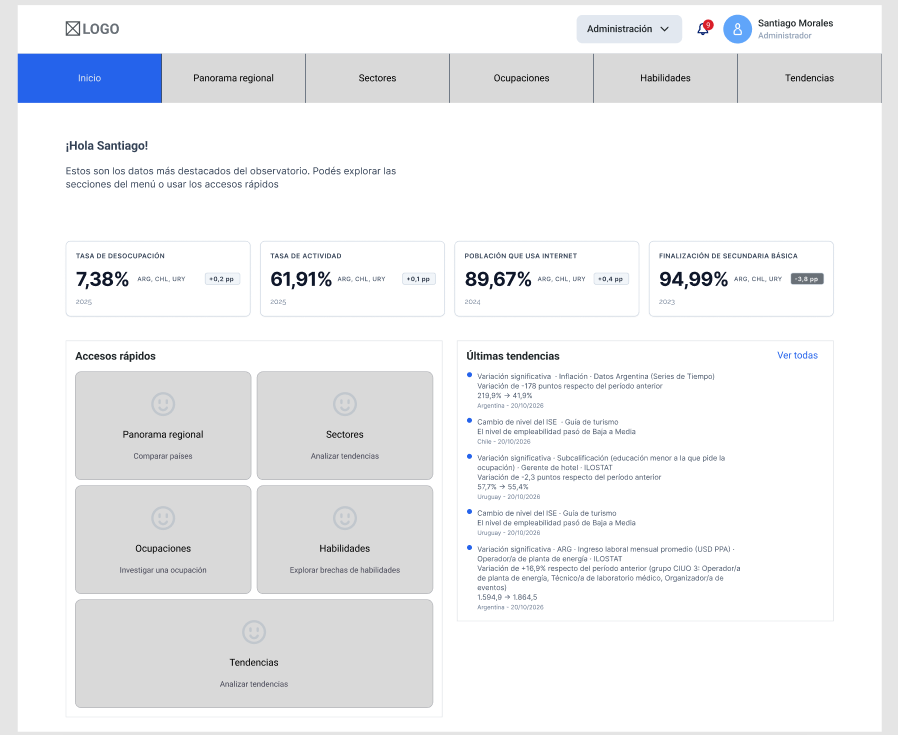
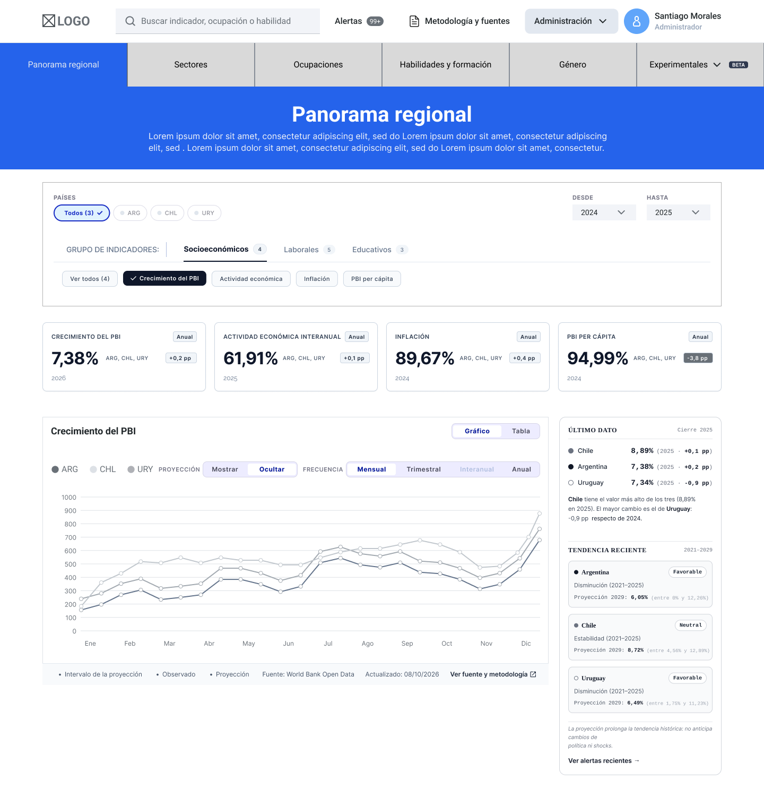
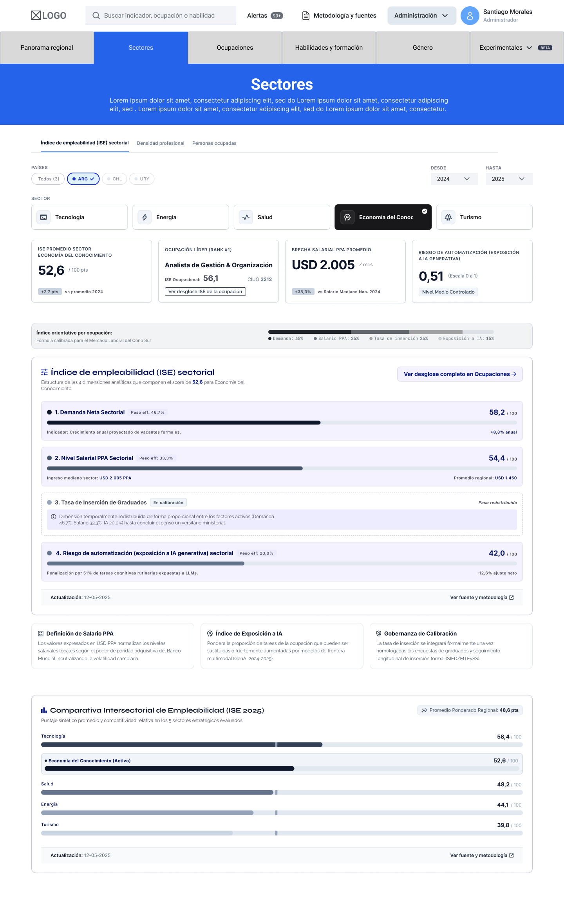
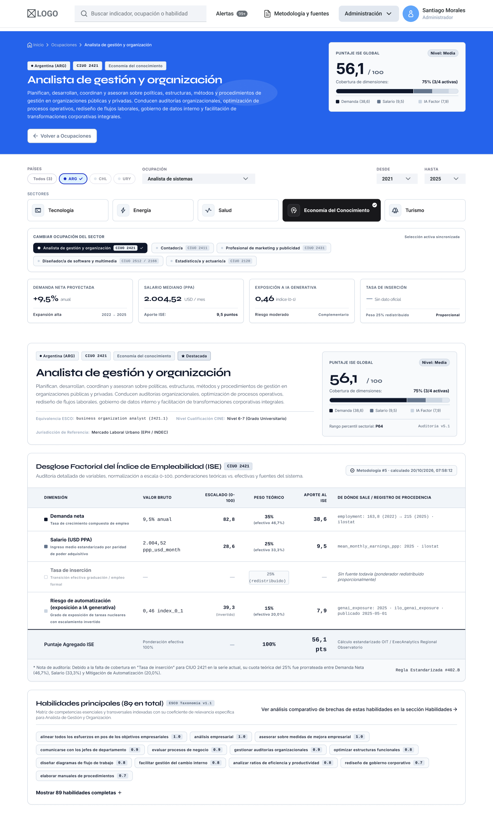
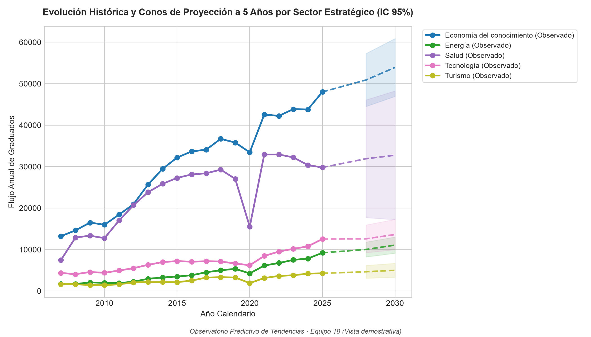
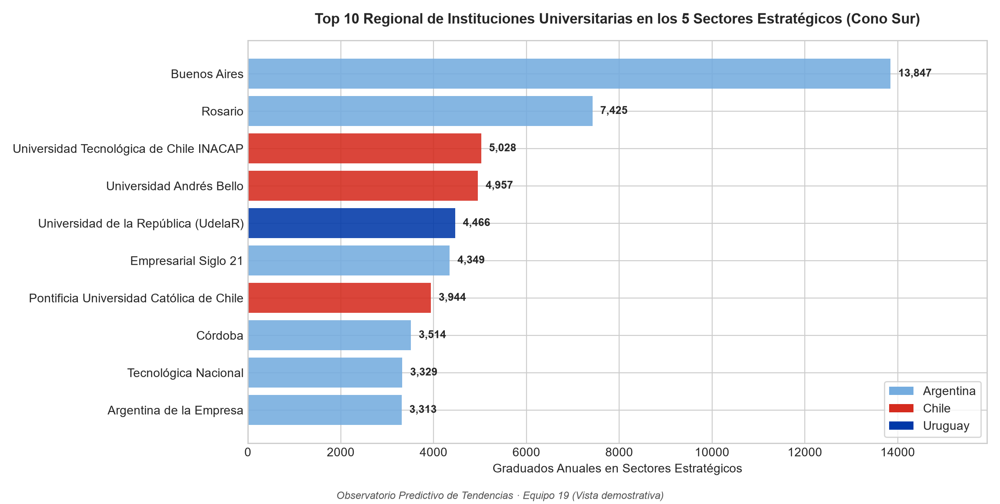
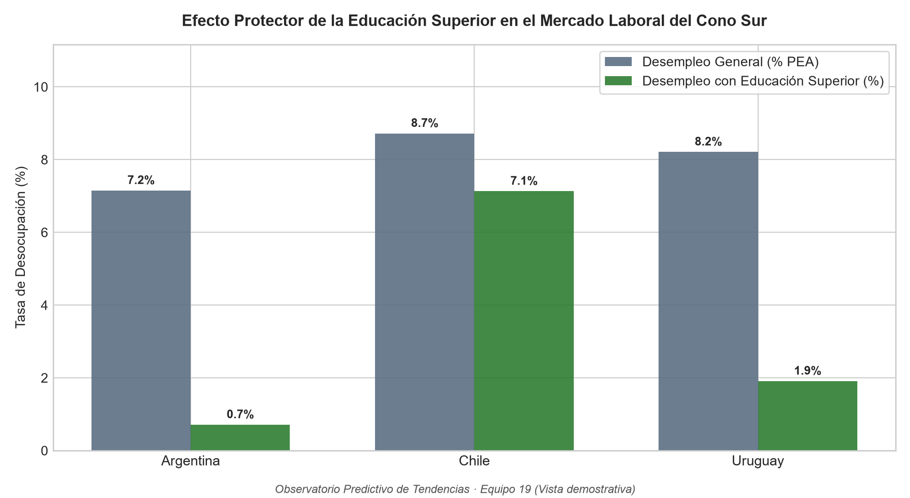

# Predix · Observatorio Predictivo Laboral y Educativo

**Alcance Regional:** Argentina, Chile y Uruguay (Cono Sur)  
**Programa:** InnovaLab  

**Predix** es una plataforma de inteligencia laboral y educativa que integra **datos 100% observados de fuentes oficiales** (ministerios de educación y trabajo, institutos estadísticos nacionales, OIT, Banco Mundial y ESCO) para analizar la evolución del empleo, salarios reales/PPA, graduación universitaria, brechas de género y el impacto de la Inteligencia Artificial en **5 sectores estratégicos**: *Tecnología, Economía del Conocimiento, Salud, Energía y Turismo*.

---

## Qué ofrece el producto

* **Panorama Regional y Proyecciones:** Series históricas armonizadas entre Argentina, Chile y Uruguay con modelos de tendencia y conos de incertidumbre al 95% de confianza.
* **Índice Sintético de Empleabilidad (ISE):** Ranking comparativo de 436 ocupaciones (CIUO-08) combinando demanda laboral neta, salario en USD PPA y riesgo de automatización por IA (OIT WP 140).
* **Educación Superior y Brechas de Habilidades:** Seguimiento de titulados por carrera e institución (homologados vía UNESCO CINE-F 2013), densidad profesional, desajuste educativo y cruce con competencias esenciales/opcionales de ESCO.
* **Diagnóstico de Género:** Análisis de paridad en graduación, empleo y brecha salarial bajo el estándar internacional EIGE/OIT (40%–60%).
* **Pulso Laboral:** Monitoreo observacional de ofertas reales de empleo (LinkedIn) por sector y provincia.
* **Indicadores Experimentales:** Modelos analíticos propios (*Moctezuma*, *Ludita*, *Reina Roja* y *Sísifo*) para evaluar velocidad de recambio tecnológico, sustitución vs. complementariedad e hiperespecialización.
* **Asistente Conversacional "Baqueano":** Copiloto integrado con verificación determinista de cifras contra la base de datos (principio *anti-alucinación*).
* **Gestión de Datos y Roles:** Carga manual auditada con validación de esquemas, historial inmutable de revisiones (`data_revisions`) y control de acceso para perfiles *Consultas*, *Editor* y *Administrador*.

---

## Vista Previa del Producto

### Interfaz de la Plataforma (Frontend)

| Inicio y Resumen | Panorama Regional |
| :---: | :---: |
|  |  |

| Análisis de Sectores | Detalle de Ocupación y Habilidades |
| :---: | :---: |
|  |  |

### Visualizaciones del Motor Analítico (Data Analytics)

| Proyecciones Sectoriales (IC 95%) | Ranking Universitario Regional | Contexto Educativo-Laboral |
| :---: | :---: | :---: |
|  |  |  |

* **Prototipo Interactivo (Figma):** [Ver Prototipo Navegable](https://www.figma.com/proto/W3S2E5N9MKzAYEp90N9QhP/Gisella-Franco-s-team-library?node-id=3364-1721&p=f&t=aN25UvDngecOjWQS-1&scaling=min-zoom&content-scaling=fixed&page-id=3316%3A2&starting-point-node-id=3364%3A1721)
* **Tablero de Arquitectura y UX (Miro):** [Ver Tablero Central](https://miro.com/app/board/uXjVHI5DvM=/)

---

## Stack Tecnológico Resumido

| Área | Tecnologías Principales |
| :--- | :--- |
| **Data Analytics** | Python 3.11+, Pandas, NumPy, SciPy, Statsmodels, Matplotlib, Configuraciones YAML |
| **Backend & API** | FastAPI, PostgreSQL 17 (Docker / Supabase), SQLAlchemy, Alembic, APScheduler, Ollama / OpenRouter |
| **Frontend** | Next.js (App Router), TypeScript, Tailwind CSS, shadcn/ui, Recharts, Zod, TanStack Query, nuqs, lucide-react |
| **Testing & QA** | Playwright (E2E y API Testing), Pytest (270+ tests en Backend) |
| **Diseño UX/UI** | Figma, Miro, Google Drive |

---

## Cómo hacerlo funcionar (Guía Rápida)

### Requisitos previos
* **Python 3.11+**, **Node.js 20.9+** y **Git**.
* **Docker Desktop** (para levantar la base PostgreSQL local).

### 1. Levantar el Backend (API + Base de Datos)
El backend se ejecuta en el puerto `8010`.

```bash
cd backend/backend

# 1. Crear y activar entorno virtual
python -m venv .venv
# En Windows (PowerShell): .venv\Scripts\Activate.ps1
# En Linux / macOS:        source .venv/bin/activate

# 2. Instalar dependencias y configurar variables de entorno
pip install -e ".[dev]"
cp .env.example .env   # En Windows: copy .env.example .env

# 3. Iniciar PostgreSQL, correr migraciones y cargar semillas
docker compose up -d
alembic upgrade head
python -m seeds.load

# 4. Ingestar fuentes oficiales, matrices analíticas y recalcular indicadores
python -m app.jobs.run --all
python -m app.ingestion.load_analytics
python -m app.jobs.recompute

# 5. Iniciar el servidor FastAPI
uvicorn app.main:app --reload --port 8010
```
* **Swagger Docs:** `http://localhost:8010/docs`
* **Explorer (herramienta de revisión en vivo):** `http://localhost:8010/explorer`

### 2. Levantar el Frontend
El frontend se desarrolla en la carpeta `frontend/frontend` (rama `landing-login`) y corre en el puerto `3000`:

```bash
cd frontend/frontend

# 1. Instalar dependencias
npm install

# 2. Configurar variables de entorno
cp .env.example .env.local   # En Windows: copy .env.example .env.local
                             # Apunta por defecto a NEXT_PUBLIC_API_URL=http://localhost:8010

# 3. Levantar el servidor de desarrollo
npm run dev                  # Abre http://localhost:3000
```
*(Nota: Si el backend no está levantado o `NEXT_PUBLIC_USE_MOCKS=true`, la plataforma permite visualizarse con datos de ejemplo).*

### 3. Ejecutar el Pipeline de Data Analytics (Opcional / Laboratorio)
Para regenerar las tablas analíticas, gráficos estáticos y la matriz de habilidades e IA desde cero:

```bash
cd data_analytics
python -m venv .venv && .venv\Scripts\Activate.ps1
pip install -r requirements.txt

python pipeline.py --etapa 1
python pipeline.py --etapa 2 --force
python pipeline.py --etapa 3
python generar_matriz_habilidades_ia.py
```

### 4. Ejecutar las Pruebas Automatizadas (QA / Testing)
Con el backend (`:8010`) y el frontend (`:3000`) corriendo:

```bash
cd tester
npm install
npx playwright install chromium
npm test               # Corre pruebas de API y navegación E2E
npm run reporte        # Abre el reporte visual con capturas
```

---

## Resumen de Pruebas y Resultados

El aseguramiento de calidad de **Predix** abarca pruebas unitarias/integración en el motor de datos y pruebas End-to-End (E2E) sobre la plataforma:

* **Pruebas de Backend (`pytest` en `backend/backend/tests/`):** Más de 270 pruebas automatizadas en memoria que validan conectores oficiales, cálculo del ISE, tendencias, homologaciones, validación de archivos de carga manual y verificación anti-alucinación de cifras en el asistente *Baqueano*.
* **Pruebas Automáticas de QA (`Playwright` en `tester/tests/`):**
  * `api.spec.js`: Verifica disponibilidad del servicio (`/health`), catálogo tripartito de países (`/api/v1/countries`) y sectores estratégicos (`/api/v1/sectors`). **Resultado:** 3/3 pruebas aprobadas.
  * `navegacion.spec.js`: Verifica renderizado sin errores inesperados y navegación entre las vistas principales (*Inicio, Panorama, Sectores, Ocupaciones, Habilidades, Experimental y Metodología*). **Resultado:** 12 pruebas ejecutadas en el ciclo de control local (9 aprobadas en primera corrida; se documentaron y ajustaron las validaciones de encabezado `h1` en *Panorama* y *Pulso laboral* y el requisito de recálculo previo para *Moctezuma*).
* **Pruebas Manuales Funcionales:** Verificación de responsividad móvil, filtrado interactivo por rango de años y sector, despliegue de competencias esenciales/opcionales ESCO en fichas de ocupación, trazabilidad de fuentes y respuestas del asistente *Baqueano*.

El detalle completo de los casos de prueba y bitácora de ejecución se encuentra en el `README` de `tester`.

---

## Documentación Detallada por Módulo

Para mantener este documento ágil, la especificación profunda de cada área se encuentra en su propio `README`:

* **Data Analytics ([`data_analytics/README.md`](data_analytics/README.md)):** Detalla la metodología científica, el inventario completo de fuentes oficiales de Argentina, Chile y Uruguay, las reglas de homologación internacional (CINE-F, CIIU, CIUO-08, ESCO) y las fórmulas matemáticas con las que fueron calculados todos los índices y proyecciones.
* **Backend y Despliegue ([`backend/README.md`](backend/README.md) y [`backend/docs/despliegue.md`](backend/docs/despliegue.md)):** Explica la arquitectura de conectores automáticos, la configuración declarativa en archivos YAML, el funcionamiento del asistente *Baqueano*, el flujo de carga manual de datos y la guía de despliegue en Supabase, Render y Vercel.
* **Frontend ([`frontend/frontend/README.md`](https://github.com/e19-innovalab/observa_tendencias/blob/landing-login/frontend/frontend/README.md)):** Documenta la instalación y scripts de Next.js, configuración de variables de entorno (`NEXT_PUBLIC_API_URL`, `NEXT_PUBLIC_USE_MOCKS`, `ADMIN_API_KEY` vía Route Handlers), arquitectura de carpetas (`src/app/`, `src/components/ui/`, `src/lib/schemas/api.ts`), validación de contratos con Zod y reglas de desarrollo del equipo de Frontend.
* **Diseño UX/UI ([`desing/README.md`](desing/README.md)):** Reúne la investigación de usuarios, arquitectura de información, definición de permisos por rol, estado de los wireframes y enlaces a los archivos editables en Figma, Miro y Google Drive.
* **Testing y QA ([`tester/README.md`](https://github.com/e19-innovalab/observa_tendencias/blob/testing/pruebas/tester/README.md)):** Describe las pruebas automáticas en Playwright (`api.spec.js` y `navegacion.spec.js`), el checklist de pruebas manuales por sección y el registro de resultados.

---

## A futuro se incluirá

* 
* 
* 
