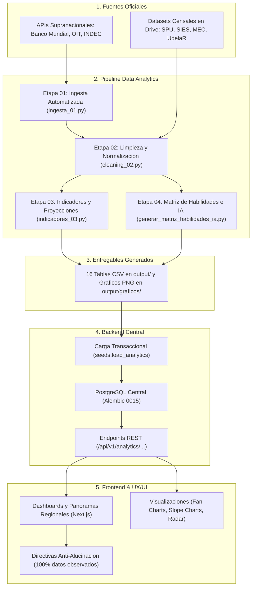

# Observatorio Predictivo de Tendencias · Módulo Data Analytics

**Alcance Regional:** Argentina, Uruguay y Chile  
**Programa:** InnovaLab  
**Rol del Módulo:** Ingesta, limpieza, armonización multipaís, cálculo de indicadores estadísticos, proyecciones de tendencias socioeconómicas, laborales y educativas, y articulación formativa-ocupacional con impacto de Inteligencia Artificial.  
**Norma Metodológica:** 100% Datos Observados Oficiales (Cero imputaciones sintéticas, estimaciones figuradas ni sustituciones artificiales).

---

## 1. Visión General del Módulo y Principios Metodológicos

Este módulo constituye la capa autónoma de analítica de datos del **Observatorio Predictivo de Tendencias**. Su objetivo es integrar fuentes oficiales de empleo, salarios, educación superior y series macroeconómicas de **Argentina, Chile y Uruguay**, para normalizarlas y producir métricas comparables, modelos de tendencia a 3 y 5 años con intervalos de confianza al 95%, diagnósticos de género, análisis institucional universitario y matrices de habilidades frente a la transformación tecnológica.

### Condiciones Básicas y Principios Metodológicos:

1. **100% Datos Observados:** No se aplican sustituciones sintéticas, datos inventados ni imputaciones calculadas. Cada dato proviene directamente de fuentes y relevamientos oficiales de los ministerios, organismos estadísticos nacionales y agencias supranacionales.
2. **Aislamiento e Independencia Operativa:** El módulo opera de forma autónoma. No requiere conectarse a bases de datos activas del backend para procesar la analítica ni exporta directamente en directorios ajenos a `data_analytics/`.
3. **Paridad Internacional:**
   * Comparación estricta de los mismos **5 sectores estratégicos**: *Tecnología, Economía del conocimiento, Salud, Energía y Turismo*.
   * Homologación de carreras y disciplinas según clasificaciones internacionales estándar (**UNESCO CINE-F 2013 / UNSD CIIU Rev. 4 / OIT CIUO-08**).
   * Conversión de salarios en moneda local (ARS, CLP, UYU) a **USD PPA (Paridad de Poder Adquisitivo)** utilizando los factores oficiales del Banco Mundial deflactados a precios constantes base 2016=100.
4. **Armonización de Género:** Estandarización de categorías en **F** (femenino), **M** (masculino), **NB** (no binario / indefinido, reportado en Chile) y opción de totalización segregada sin alterar las proporciones observadas.
5. **Auditoría e Inspección Continua con Agentes de IA en Antigravity:** El diseño metodológico, la depuración del código, la inspección de consistencia matemática y la validación de paridad de este módulo se desarrollan mediante pair programming en **Google Antigravity**, apoyándose en agentes de IA para realizar revisiones exhaustivas paso a paso, trazabilidad en bitácoras y pruebas de estrés de los algoritmos.

---

## 2. Stack Tecnológico

El módulo de Data Analytics está construido sobre un ecosistema científico en Python, integrando librerías especializadas en procesamiento de datos masivos, modelado estadístico, consumo de APIs oficiales y estándares taxonómicos internacionales:

| Capa / Dominio | Tecnología / Herramienta | Rol y Función en el Módulo |
|---|---|---|
| **Lenguaje Base** | Python 3.11+ (validado en 3.15) | Núcleo del pipeline de datos, tipado estricto y scripts de orquestación autónomos. |
| **Entorno y Aislamiento** | Entorno virtual (`venv`) | Aislamiento de paquetes para garantizar reproducibilidad e independencia operativa. |
| **Manipulación de Datos** | `pandas` (>= 2.2.0) | Limpieza, estructuración tabular, cruces de hechos/dimensiones y armonización multipaís. |
| **Cálculo Numérico** | `numpy` (>= 1.26.0) | Operaciones matriciales vectorizadas, agregaciones rápidas y gestión estricta de `NaN`. |
| **Estadística y Proyecciones** | `scipy` (>= 1.12.0) | Z-scores de dinamismo, regresiones lineales y conos de proyección a 3 y 5 años con $t$-Student al 95%. |
| **Ingesta y APIs** | `requests` (>= 2.31.0) | Conexión con APIs REST oficiales y supranacionales (Banco Mundial, INDEC). |
| **Lectura de Formatos** | `openpyxl`, `odfpy`, `csv`, `zipfile` | Extracción automatizada de censos y anuarios en `.xlsx`, `.ods`, `.zip` y `.csv` (RFC 4180 / UTF-8). |
| **Visualización** | `matplotlib` (>= 3.8.0) | Generación de gráficos analíticos de alta resolución (.png a 300 DPI) y fan charts. |
| **Taxonomías y Estándares** | UNESCO CINE-F 2013, CIIU Rev. 4 / CLAE2, OIT CIUO-08 / ESCO, Banco Mundial WDI | Homologación internacional de carreras, sectores económicos, competencias ocupacionales y paridad PPA / IPC. |
| **Entornos de Desarrollo (IDE)** | Google Antigravity IDE, Visual Studio Code | Entorno de ejecución coordinada, inspección de terminales y control de flujo. |
| **Pair Programming con IA** | Claude AI, Modelos Google (Gemini en Antigravity) | Auditoría metodológica, refactorización modular, pruebas de estrés algorítmico y consistencia matemática. |
| **Versionado y Almacenamiento** | Git / GitHub, Google One / Google Drive | Control de versiones colaborativo y resguardo centralizado de datasets censales crudos de gran volumen. |

---

## 3. Arquitectura del Flujo de Datos Extremo a Extremo (Pipeline a Producción)

El Observatorio opera bajo una arquitectura de flujo desacoplada y unidireccional: la capa de analítica produce datasets inmutables, la capa de backend los ingesta de forma transaccional en PostgreSQL, y la capa de frontend los consume vía API REST para su representación gráfica.



| Capa del Sistema | Tecnologías / Módulos | Entradas y Procesamiento | Salidas Generadas |
|---|---|---|---|
| **1. Fuentes Oficiales** | APIs REST + Google Drive | Series de ARG, CHL, URY (SPU, CEP-XXI, INDEC, SIES, MEC, UdelaR, BM, OIT) | JSON directo y archivos crudos en `data/raw/` |
| **2. Data Analytics** | `ingesta_01.py`, `cleaning_02.py`, `indicadores_03.py`, `generar_matriz_habilidades_ia.py` | Homologación CINE-F/CIIU/CIUO-08, USD PPA, Z-scores, regresiones y conos t-Student 95% | 16 tablas CSV en `output/` y 7 gráficos PNG en `output/graficos/` |
| **3. Backend Central** | FastAPI, PostgreSQL, SQLAlchemy, Alembic | Carga transaccional por lotes (`seeds.load_analytics`: 179k filas en 18s) | Endpoints REST `/api/v1/analytics/...` |
| **4. Frontend & UX/UI** | Next.js, TypeScript, Tailwind, Recharts | Consumo de APIs REST con validación estricta de esquemas Pydantic | Fan Charts interactivos, Slope Charts, Radar y estados anti-alucinación |


### Puntos de Contacto Interdisciplinarios:

* **Data Analyst $\rightarrow$ Backend Developer:** Entrega los archivos normalizados en `data_analytics/output/` junto con el catálogo de esquemas y tipos de datos.
* **Backend Developer $\rightarrow$ Frontend Developer:** Expone los endpoints en `/api/v1/analytics/` cumpliendo los esquemas Pydantic y contratos JSON documentados en `catalogo_datos_frontend_ux.md`.
* **Frontend Developer $\leftarrow$ UX/UI Designer:** Implementa las directivas visuales (Fan Charts con bandas sombreadas al 95%, comparativas salariales en USD PPA y tooltips metodológicos explicativos).

---

## 4. Inventario Maestro de Fuentes Oficiales (Qué datos se utilizan)

El Observatorio integra únicamente fuentes primarias auditadas de Argentina, Chile, Uruguay y organismos internacionales:

| Ámbito | Organismo | Fuente / Relevamiento | Período Observado | Formato / Acceso | Indicadores Clave Obtenidos |
|---|---|---|---|---|---|
| **Argentina** | SPU / Min. Capital Humano | Base SIU-Araucano y Anuarios SPU | 2016–2018 (Araucano), 2020–2022 (Anuarios) | XLSX / ZIP (Descarga Drive) | Egresados universitarios por carrera, disciplina y sexo (F/M). |
| **Argentina** | CEP-XXI / Min. Economía | Series de Puestos y Salarios CLAE2 | 2007–2023 (11 meses en 2023) | CSV (Descarga Drive) | Empleo privado formal, salarios medios y medianos ponderados. |
| **Argentina** | INDEC | API Oficial de Series de Tiempo | 2016–2026 (117 meses) | JSON (API REST directa) | IPC Nacional base dic-2016=100 para deflación de series. |
| **Chile** | Subsecretaría Educ. Superior | Base Histórica Mi Futuro | 2007–2025 | XLSX (Descarga Drive) | Titulados por carrera, institución, tipo y sexo (F/M/NB). |
| **Chile** | SIES / Min. Educación | Buscador Empleabilidad e Ingresos | 2016–2024 / 2024–2025 | XLSX (Descarga Drive) | Ingresos al 1° y 4° año, empleabilidad al 1° y 2° año de egreso. |
| **Uruguay** | MEC - Div. Estadística | Datos Abiertos Educación Superior | 2014–2023 | CSV (Descarga Drive) | Egresados terciarios/universitarios por área y disciplina. |
| **Uruguay** | UdelaR (Dirección Planeamiento) | Serie Histórica de Egresos | 2000–2024 | ODS (Descarga Drive) | Egresos de grado por facultad y carrera universitaria. |
| **Uruguay** | INE Uruguay | Encuesta Continua de Hogares (ECH) | 2015–2024 | CSV (Descarga Drive) | Distribución de empleo formal por rama de actividad económica. |
| **Supranacional** | Banco Mundial (WDI) | World Development Indicators API | 2010–2025 | JSON (API REST directa) | Factores PPA del PIB (`PA.NUS.PPP`), IPC (`FP.CPI.TOTL`) y desempleo. |
| **Supranacional** | OIT (ILOSTAT) | Indicadores Laborales SDMX/API | 2011–2024 / 2024 | CSV (API REST directa) | Salarios medios mensuales (`EAR_EMTA_SEX_ECO_NB`) y ocupación formal. |
| **Supranacional** | CEPALSTAT | Bases Estadísticas Sociales | 2010–2024 | JSON (API REST directa) | Tasa bruta de matrícula terciaria y jóvenes en estudios superiores. |
| **Mercado Laboral** | Observatorio / LinkedIn | Scraping de Avisos Cono Sur | 2024–2026 | CSV (Muestra observada) | 640 publicaciones de empleo, perfiles y habilidades demandadas. |

---

## 5. Guía de Instalación y Ejecución Local Paso a Paso

Sigue esta guía secuencial para configurar el entorno desde cero, estructurar el directorio de datasets crudos y ejecutar el pipeline completo comando por comando.

### Requisitos Previos del Sistema:
* **Python 3.11 o superior** instalado (probado y validado en Python 3.15).
* Terminal con soporte para PowerShell (Windows), Bash o CMD.
* Conexión a Internet para la descarga inicial de librerías y consulta de APIs REST.

---

### Paso 1: Posicionarse en el directorio del módulo
Abre una terminal y sitúate en la raíz del módulo `data_analytics`:

```bash
cd c:/proyectos/observa_tendencias/data_analytics
```

---

### Paso 2: Crear y activar el entorno virtual de Python
Es fundamental trabajar en un entorno virtual aislado para evitar colisiones con librerías globales:

```bash
# Crear el entorno virtual en la carpeta .venv:
python -m venv .venv

# Activar en Windows (PowerShell):
.venv\Scripts\Activate.ps1

# (O si utilizas Windows CMD clásico):
# .venv\Scripts\activate.bat

# (O si utilizas Linux / macOS / Git Bash):
# source .venv/bin/activate
```

---

### Paso 3: Instalar las dependencias del proyecto
Actualiza el gestor de paquetes e instala las librerías científicas requeridas:

```bash
pip install --upgrade pip
pip install -r requirements.txt
```

---

### Paso 4: Crear la estructura de carpetas `data/raw/`
Debido a que Git ignora los datasets crudos pesados, se deben crear manualmente las carpetas de almacenamiento local:

```bash
# En Windows PowerShell:
New-Item -ItemType Directory -Force -Path "data/raw/argentina", "data/raw/chile", "data/raw/uruguay", "data/raw/linkedin_jobs"

# En Linux / macOS / Git Bash:
# mkdir -p data/raw/argentina data/raw/chile data/raw/uruguay data/raw/linkedin_jobs
```

---

### Paso 5: Descarga manual de datasets desde Google Drive e ingreso a `data/raw/`

> [!IMPORTANT]
> **Debes descargar los datasets oficiales desde la carpeta compartida de Google Drive** del equipo e ingresarlos en sus carpetas locales correspondientes, respetando **estrictamente los nombres de archivo exactos**:

#### Ubicación 1: `data/raw/argentina/`
* `base_araucano_traducida.xlsx` *(Base de graduados universitarios SIU-Araucano 2016-2018)*
* `anuario_csv_2020.zip` *(SPU Anuario Estadístico Universitario 2020)*
* `anuario_csv_2021.zip` *(SPU Anuario Estadístico Universitario 2021)*
* `anuario_csv_2022.zip` *(SPU Anuario Estadístico Universitario 2022)*
* `puestos_privados_mensual_por_clae2.csv` *(Empleo registrado mensual CEP-XXI)*
* `w_mean_privado_mensual_por_clae2.csv` *(Salario medio registrado CEP-XXI)*
* `w_median_privado_mensual_por_clae2.csv` *(Salario mediano registrado CEP-XXI)*
* `share_mujer_privado_mensual_por_clae2.csv` *(Participación femenina CEP-XXI)*

#### Ubicación 2: `data/raw/chile/`
* `TITULADO_2007-2025_web_27_05_2026_E-1.xlsx` *(Base censal histórica de titulados de Mi Futuro)*
* `Buscador_Estadisticas_por_carrera_2024_2025_SIES.xlsx` *(Estadísticas por carrera del SIES)*
* `Buscador_Empleabilidad_e_Ingresos_2024_2025_SIES.xlsx` *(Ingresos y empleabilidad oficial SIES)*

#### Ubicación 3: `data/raw/uruguay/`
* `00._educ_superior_datos.csv` *(Educación Superior del MEC 2014-2023)*
* `1.Serie-Egresos-totales-Grado-por-Servicio-2000-2024.ods` *(Serie histórica de egresos de UdelaR)*
* `Anuario Estadístico de Educación 2024.xlsx` *(Anuario oficial MEC)*
* `10235_distribucion_porcentual_de_las_personas_ocupadas_segun_sexo_por_rama_de_actividad_en_ocupa.csv` *(Mercado laboral INE Uruguay)*

#### Ubicación 4: `data/raw/linkedin_jobs/` *(opcional / exploración)*
* Publicaciones laborales en formato `.csv` recopiladas para monitoreo de demanda.

*(Nota: Las series de Banco Mundial WDI, OIT ILOSTAT, CEPALSTAT e INDEC IPC no requieren descarga manual; el pipeline las consulta directamente vía API).*

---

### Paso 6: Ejecución Comando por Comando del Pipeline

Puedes recorrer el pipeline ejecutando cada etapa en secuencia mediante la terminal:

#### 1. Etapa 01: Ingesta de APIs y verificación de fuentes
Descarga automáticamente las series supranacionales del Banco Mundial, CEPALSTAT, ILOSTAT e INDEC, verifica la integridad de los archivos en `data/raw/` y descomprime los anuarios SPU:
```bash
python pipeline.py --etapa 1
```
*Salida generada:* `output/resumen_ingesta.csv` y descompresión de archivos zip.

#### 2. Etapa 02: Limpieza, armonización y modelo dimensional
Procesa las planillas masivas, normaliza carreras bajo UNESCO CINE-F 2013, estandariza sectores bajo CIIU Rev. 4, calcula salarios en USD PPA y exporta las tablas de hechos y dimensiones maestras:
```bash
python pipeline.py --etapa 2
```
*(Si ya existen cachés previas y deseas forzar su reconstrucción completa desde los archivos crudos, agrega la bandera `--force`: `python pipeline.py --etapa 2 --force`).*  
*Salidas generadas:* `output/hecho_egresados.csv`, `output/hecho_salario.csv`, `output/hecho_instituciones_egresados.csv`, tablas de dimensiones y cachés en `data/processed/`.

#### 3. Etapa 03: Indicadores estadísticos, Z-scores, proyecciones y gráficos
Calcula tasas interanuales, Z-scores de dinamismo ($|Z| \ge 1.4$), proyecciones a 3 y 5 años con $t$-Student al 95%, tasas de densidad profesional, brechas de género observadas y genera las visualizaciones analíticas:
```bash
python pipeline.py --etapa 3
```
*Salidas generadas:* `output/proyecciones_graduados_sector.csv`, `output/indicadores_interanuales_zscore.csv`, `output/reporte_densidad_profesional_sector.csv`, reportes salariales y gráficos PNG en `output/graficos/`.

#### 4. Etapa 04: Generación de la Matriz Integral de Habilidades y Riesgo IA
Articula las 25 carreras con 54 ocupaciones CIUO-08, clasifica las 4 tipologías de competencias y calcula los gradientes de exposición a IA según el reporte OIT Working Paper 140:
```bash
python generar_matriz_habilidades_ia.py
```
*Salidas generadas:* `output/matriz_habilidades_sectoriales_integrales.csv` y `output/matriz_habilidades_riesgo_ia_sector.csv`.

---

### Ejecución Integral en un solo comando:
Si prefieres correr las tres primeras etapas automáticamente de punta a punta:
```bash
python pipeline.py
python generar_matriz_habilidades_ia.py
```

---

## 6. Funcionalidad de los Módulos del Pipeline

### `01 · src/ingesta_01.py` (Ingesta Automatizada)
1. **Descompresión Inteligente:** Detecta y extrae autónomamente paquetes `.zip` en `data/raw/` (como los anuarios universitarios de Argentina).
2. **APIs Oficiales Consumidas:**
   * **Banco Mundial:** Factores de Paridad de Poder Adquisitivo (`PA.NUS.PPP` y `PA.NUS.PRVT.PP`), IPC (`FP.CPI.TOTL`) y series de desempleo.
   * **CEPALSTAT:** Tasa bruta de matrícula terciaria (ID 99), desocupación por sexo (ID 127) y jóvenes en estudios superiores (ID 5701).
   * **ILOSTAT (OIT):**
     * Serie de salarios medios mensuales de asalariados por rama de actividad (CIIU Rev. 4) y sexo (`EAR_EMTA_SEX_ECO_NB`) para Argentina, Chile y Uruguay.
     * Serie de ocupación laboral desagregada por nivel educativo y rama (`EMP_TEMP_SEX_ECO_NB`).
3. **Auditoría de Ingesta:** Inspecciona y verifica la integridad de las fuentes locales y genera `output/resumen_ingesta.csv`.

### `02 · src/cleaning_02.py` (Limpieza y Armonización)
1. **Mapeo y Clasificación:** Mapea más de 20 carreras objetivo en los 5 sectores estratégicos con expresiones regulares y normalización fonética/ortográfica bajo CINE-F.
2. **Chile:** Normaliza la serie histórica de egresados de Mi Futuro (2007-2025) por institución e integra salarios en CLP al 1er año y empleabilidad desde SIES.
3. **Argentina:** Procesa la base de graduados SIU-Araucano (2016-2018) y los anuarios SPU (2020-2022) totalizando 6 años observados continuos en los 5 sectores estratégicos, e integra salarios medios/medianos y puestos formales por CLAE2 ponderados desde CEP-XXI (2007-2023).
4. **Uruguay:** Normaliza la base de Educación Superior del MEC (2014-2023), integra egresos del Anuario MEC 2024 y la serie histórica de UdelaR (2000-2024), e incorpora el relevamiento de empleo por sexo del INE Uruguay.
5. **Capa Salarial Supranacional OIT:** Procesa `EAR_EMTA_SEX_ECO_NB` para ARG, CHL y URY, estandariza a secciones CIIU Rev. 4 (D, I, J, M, Q) y deflacta a **USD PPA** mediante factores del Banco Mundial.
6. **Modelado Dimensional:** Exporta tablas de hechos (`hecho_egresados`, `hecho_instituciones_egresados`, `hecho_salario`, `hecho_ocupacion_terciarios`) y dimensiones maestras (`dim_pais`, `dim_sector`, `dim_carrera`, `dim_sexo`, `dim_tiempo`, `puente_carrera_sector`).

### `03 · src/indicadores_03.py` (Indicadores y Proyecciones)
1. **Tasas Interanuales y Z-Scores:** Mide el crecimiento relativo interanual y la aceleración estandarizada (Z-score con umbral $|Z| \ge 1.4$) por país y sector.
2. **Proyecciones Lineales con $t$-Student:** Modela tendencias de egresados a 3 y 5 años con intervalos de confianza al 95% para las series con $n \ge 5$ años observados (los 15 estratos de ARG, CHL y URY son 100% elegibles y proyectables).
3. **Semáforo Presupuestario:** Recomienda prioridades formativas (`ALTA`, `MEDIA`, `BAJA PRIORIDAD`) para los 3 países según pendientes estadísticas.
4. **Comparativa Salarial Regional Multipais:** Matriz tripartita en USD PPA homologado bajo la serie supranacional de la OIT 2024 (`reporte_brecha_salarial_regional.csv`), complementada por la granularidad de CEP-XXI y SIES (`reporte_salarios_detalle_local.csv`).
5. **Diagnóstico Integral de Género y Brecha Salarial Observada:** Calcula tasas porcentuales de graduadas por sexo (F, M, NB) y empleo formal, junto a la brecha salarial observada OIT 2024.
6. **Rankings Universitarios:** Top 10 Regional en el año común tripartito 2022 y rankings nacionales anualizados.

---

## 7. Metodología de Análisis e Indicadores Clave (Cómo se analiza)

### 1. Modelado Predictivo con Intervalos $t$-Student al 95%:
Para cada estrato país-sector con $n \ge 5$ años censales continuos, se ajusta una regresión lineal por mínimos cuadrados ordinarios:
$$\hat{Y}_t = \beta_0 + \beta_1 \cdot t$$
El intervalo de predicción para un año futuro $t_0$ con nivel de confianza del 95% se calcula mediante la distribución $t$-Student con $n - 2$ grados de libertad:
$$\text{IC}_{95\%} = \hat{Y}_{t_0} \pm t_{crit} \cdot S_{e} \cdot \sqrt{1 + \frac{1}{n} + \frac{(t_0 - \bar{t})^2}{\sum (t_i - \bar{t})^2}}$$
Donde $S_e$ es el error estándar de los residuos. Esto produce bandas de incertidumbre ensanchadas a medida que la proyección se aleja en el tiempo.

### 2. Z-Score de Dinamismo y Control de Consecutividad Temporal:
Mide si la tasa de crecimiento interanual de egresados en un año determinado se desvía anómalamente del promedio histórico del sector:
$$Z = \frac{\Delta\% - \mu_{\Delta\%}}{\sigma_{\Delta\%}}$$
* **Umbral homogéneo:** $|Z| \ge 1.4$, calibrado para series cortas/moderadas respetando el límite algebraico de Shiffler.
* **Control de consecutividad:** Si $t - (t-1) \ne 1$ año (por ejemplo, Argentina 2020 tras la ausencia de 2019), la tasa interanual queda estrictamente como `NaN` para evitar promediar un salto bienal como si fuera anual.

### 3. Tasa de Densidad Profesional y Renovación Laboral:
Cruza la oferta educativa superior con la demanda de empleo formal observada por la OIT:
$$\text{Densidad Profesional} = \frac{\text{Graduados Universitarios Anuales}}{\text{Personas Ocupadas en el Sector (OIT)}} \times 1.000$$
Indica el volumen de egresados que ingresan anualmente al sistema por cada 1.000 trabajadores activos.

### 4. Paridad Salarial en USD PPA del PIB y Precios Constantes:
Para comparar salarios reales entre Argentina, Chile y Uruguay sin distorsiones cambiarias:
$$\text{Salario USD PPA} = \frac{\text{Salario en Moneda Local (ARS, CLP, UYU)}}{\text{Factor PPA del PIB (PA.NUS.PPP del Banco Mundial)}}$$
Las series temporales se deflactan a moneda constante mediante el IPC oficial armonizado base común $2016 = 100.0$.

### 5. Tratamiento Transparente del Índice Sintético de Empleabilidad (ISE):
Dado que Chile cuenta con relevamiento censal anual de inserción formal a 1 y 2 años (SIES) pero Argentina y Uruguay no disponen de mediciones censales continuas, en la comparativa regional el peso nominal del 25% de inserción se **redistribuye proporcionalmente** entre las variables con datos 100% observados en los 3 países:
* Demanda Neta Observada: **46.7%** (nominal 35%)
* Salario USD PPA Observado: **33.3%** (nominal 25%)
* Riesgo de Automatización OIT: **20.0%** (nominal 15%)
En la ficha local de Chile, la tasa observada de SIES se muestra de forma informativa sin afectar la paridad de los otros países.

### 6. Matriz de Habilidades y Gradientes de Exposición a IA (OIT WP 140 / 2025):
La matriz articula 114 cruces ocupacionales con 4 tipologías:
1. *Técnicas Nucleares (Hard Skills):* Competencias disciplinares específicas de cada carrera.
2. *Emergentes Sectoriales:* Transición verde, sostenibilidad, electromovilidad, bioseguridad, hospitalidad regenerativa.
3. *Transversales y Humanas:* Pensamiento crítico, ética profesional, empatía y trabajo interdisciplinario.
4. *Digitales e IA:* Asistencia por LLMs, ciencia de datos, arquitectura cloud e IoT.
Se cruza con los gradientes oficiales del reporte OIT Working Paper 140 (Gmyrek et al.):
* `Not Exposed` (0.00 - 0.20): Predominio manual/presencial sin exposición tecnológica directa.
* `Minimal Exposure` (0.20 - 0.40): Exposición asistida moderada.
* `Gradient 2` (0.40 - 0.50): Alta complementariedad con IA (aumento de tareas cognitivas).
* `Gradient 3` (0.50 - 0.60): Transformación digital profunda del perfil ocupacional.

---

## 8. Catálogo de Entregables Generados (`output/`)

### Tablas de Hechos y Datos Normalizados:
* `hecho_egresados.csv`: Serie histórica completa de graduados (ARG, CHL, URY) en los 5 sectores estratégicos (173.890 registros observados).
* `hecho_instituciones_egresados.csv`: Serie de egresados con trazabilidad institucional universitaria normalizada (4.571 registros, 187 universidades, excluyendo CFT/IP en rankings de grado).
* `hecho_salario.csv`: Salarios observados en moneda local y USD PPA (755 registros: CEP-XXI, SIES y OIT/ILOSTAT para ARG, CHL y URY).
* `hecho_ocupacion_terciarios.csv`: Puestos de trabajo, participación de mujeres y empleabilidad censal (173 registros).
* `factores_macro_ppa.csv`: Factores PPA del PIB del Banco Mundial e IPC armonizado (2010–2025).

### Reportes de Indicadores y Matrices Analíticas:
* `matriz_habilidades_sectoriales_integrales.csv`: 114 cruces formativo-ocupacionales clasificados en las 4 tipologías de competencias y articulados con el Índice OIT GenAI WP 140.
* `matriz_habilidades_riesgo_ia_sector.csv`: Versión especializada con focos de complementariedad tecnológica y validación en 640 avisos laborales de LinkedIn.
* `proyecciones_graduados_sector.csv`: Proyecciones predictivas a 3 y 5 años con intervalos $t$-Student al 95% (30 estimaciones sector-país).
* `indicadores_interanuales_zscore.csv`: Variaciones interanuales sobre años consecutivos observados y alertas $|Z| \ge 1.4$.
* `reporte_densidad_profesional_sector.csv`: Graduados por cada 1.000 personas ocupadas en el sector económico (140 registros cruzados).
* `ranking_universidades_regional.csv`: Top 10 regional de universidades evaluadas en el último año común tripartito (2022).
* `ranking_universidades_nacional.csv`: Universidades con mayor volumen de egresados en el año más reciente observado por país.
* `reporte_brecha_salarial_regional.csv`: Matriz salarial tripartita en USD PPA supranacional OIT 2024.
* `reporte_brechas_genero_detallado.csv`: Serie de participación femenina en egresados vs. empleo formal bajo estándar EIGE/OIT.

### Visualizaciones Analíticas en Alta Resolución (`output/graficos/`):
* `proyeccion_graduados_ARG.png`: Fan chart con intervalos de confianza al 95% para Argentina.
* `proyeccion_graduados_CHL.png`: Fan chart con intervalos de confianza al 95% para Chile.
* `proyeccion_graduados_URY.png`: Fan chart con intervalos de confianza al 95% para Uruguay.
* `brecha_salarial_regional_multipais.png`: Comparativa salarial regional en USD PPA.
* `analisis_genero_empleabilidad_brecha.png`: Gráfico dual de participación femenina en educación vs. empleo.
* `ranking_universidades_regional_2022.png`: Top 10 regional de universidades en el año común 2022.
* `desempleo_educacion_superior_regional.png`: Desempleo total vs. población con educación terciaria.

---

## 9. Especificaciones de Integración con Backend (Traspaso y Persistencia)

La plataforma central persiste los datos de analítica de forma transaccional en PostgreSQL. El desarrollador de backend utiliza el script de carga masiva y los esquemas DDL versionados.

### Mapeo de Entregables CSV a Base de Datos Central:

| Archivo Generado en `data_analytics/output/` | Modelo SQLAlchemy (`backend/app/models/`) | Tabla PostgreSQL | Registros Típicos |
|---|---|---|---|
| `informe_cobertura.csv` | `CoverageReport` | `coverage_report` | 15 estratos |
| `dim_pais.csv` | `DimPais` | `dim_pais` | 3 registros |
| `dim_sector.csv` | `DimSector` | `dim_sector` | 5 registros |
| `dim_tiempo.csv` | `DimTiempo` | `dim_tiempo` | 26 años |
| `dim_sexo.csv` | `DimSexo` | `dim_sexo` | 4 categorías |
| `dim_carrera.csv` | `DimCarrera` | `dim_carrera` | 25 carreras |
| `factores_macro_ppa.csv` | `FactoresMacroPPA` | `factores_macro_ppa` | 48 registros |
| `hecho_salario.csv` | `FactSalario` | `fact_salario` | 755 registros |
| `hecho_instituciones_egresados.csv` | `FactInstitucionesEgresados` | `fact_instituciones_egresados` | 4.571 registros |
| `hecho_ocupacion_terciarios.csv` | `FactOcupacionTerciarios` | `fact_ocupacion_terciarios` | 173 registros |
| `reporte_densidad_profesional_sector.csv` | `ReporteDensidadProfesional` | `reporte_densidad_profesional` | 140 registros |
| `ranking_universidades_nacional.csv` | `RankingUniversidadesNacional` | `ranking_universidades_nacional` | 231 registros |
| `ranking_universidades_regional.csv` | `RankingUniversidadesRegional` | `ranking_universidades_regional` | 10 registros |
| `analisis_genero_integral.csv` | `AnalisisGeneroIntegral` | `analisis_genero_integral` | 15 registros |
| `proyecciones_graduados_sector.csv` | `ProyeccionesGraduadosSector` | `proyecciones_graduados_sector` | 30 estimaciones |
| `hecho_egresados.csv` | `FactEgresados` | `fact_egresados` | 173.890 registros (lotes de 10k) |

### Procedimiento de Carga Transaccional:
Situarse en la carpeta del backend y ejecutar el seed automatizado:
```bash
cd c:/proyectos/observa_tendencias/backend/backend
.venv/Scripts/python -m seeds.load_analytics
```
*Tiempos de ejecución:* Aproximadamente 18 segundos para persistir los 179.886 registros observados con integridad referencial.

### Endpoints REST Analíticos en FastAPI:
* `GET /api/v1/analytics/densidad-profesional`: Consulta de densidad profesional con parámetro `enfoque` (`local`, `regional_comun`, `todos`).
* `GET /api/v1/analytics/salarios/dual`: Comparativa salarial con parámetro `enfoque` (`local` moneda constante, `regional` USD PPA).
* `GET /api/v1/analytics/ise/metodologia-insercion`: Exposición transparente de la fórmula y ponderaciones redistribuidas del ISE.
* `GET /api/v1/analytics/habilidades` (y alias `/habilidades-ia`): Consulta de competencias formativas, tipologías y exposición OIT GenAI WP 140.

---

## 10. Especificaciones de Exposición para Frontend y UX/UI (Consumo Visual)

Para el equipo de Frontend y UX/UI, la referencia canónica de contratos JSON, esquemas y tipos de datos se encuentra detallada en [catalogo_datos_frontend_ux.md](file:///c:/proyectos/observa_tendencias/data_analytics/catalogo_datos_frontend_ux.md). A continuación se resumen las directivas visuales clave:

### 1. Gráficos de Proyecciones con Conos de Incertidumbre (Fan Charts):
* **Serie Observada (Hecho Censal):** Línea continua y sólida con marcadores circulares en cada año real. Color primario.
* **Punto de Corte Censal:** Marcador destacado que indica el último año censal publicado por el país (ARG 2022, URY 2023, CHL 2025).
* **Serie Proyectada:** Línea punteada o discontinua (`stroke-dasharray="4,4"`).
* **Banda de Confianza:** Área sombreada semitransparente entre el límite inferior y superior al 95% de confianza ($t$-Student).

### 2. Enfoque Temporal Dual en Visualizaciones:
* **Ficha País / Nivel Nacional:** Mostrar la **máxima actualidad observada** de cada país para diagnóstico local (Chile 2024/2025, Uruguay 2023/2024, Argentina 2022/2023).
* **Comparativa Regional Tripartita:** Restringir el cotejo a la **ventana común armonizada (2018–2022)** para evitar comparar años dispares.

### 3. Principio Anti-Alucinación para UI:
* **No inventar datos:** Si para un año, país o carrera no existe dato censal, mostrar el estado explícito `"Dato no relevado oficialmente"`.
* **Prohibido interpolar líneas:** No unir con líneas continuas puntos que tengan vacíos intermedios.
* **Transparencia en Inserción Laboral:** Informar explícitamente que Argentina y Uruguay no disponen de censos de inserción y que el Observatorio redistribuye el peso en el ISE de forma transparente.

---

## 11. Estructura de Directorios del Módulo

```text
data_analytics/
├── data/
│   ├── raw/                             <- Datasets crudos oficiales descargados de Google Drive
│   │   ├── argentina/                   <- Base Araucano, Anuarios SPU y salarios CEP-XXI
│   │   ├── chile/                       <- Titulados Mi Futuro y estadísticas SIES
│   │   ├── uruguay/                     <- Educación Superior MEC, UdelaR y mercado laboral INE
│   │   └── linkedin_jobs/               <- Avisos laborales recopilados
│   └── processed/                       <- Cachés intermedias normalizadas (.csv)
├── output/                              <- Entregables analíticos consolidados (.csv)
│   └── graficos/                        <- Visualizaciones estadísticas en alta resolución (.png)
├── src/                                 <- Código fuente modular en Python
│   ├── __init__.py                      <- Empaquetado del módulo y función ejecutar_todo()
│   ├── ingesta_01.py                    <- Ingesta de APIs y verificación de fuentes
│   ├── cleaning_02.py                   <- Normalización, limpieza y modelo dimensional
│   └── indicadores_03.py                <- Indicadores, Z-scores, brechas y proyecciones
├── pipeline.py                          <- Orquestador del pipeline de punta a punta
├── generar_matriz_habilidades_ia.py     <- Generador de matriz de habilidades y riesgo IA
├── fuentes.yaml                         <- Inventario estructurado de fuentes oficiales y URLs
├── catalogo_datos_frontend_ux.md        <- Catálogo contractual de APIs y guía de UI/UX
├── requirements.txt                     <- Dependencias de librerías Python
└── .gitignore                           <- Reglas para evitar subir datasets pesados a Git
```

---

## 12. Diccionario de Datos y Glosario Metodológico

| Campo / Concepto | Tipo de Variable | Definición y Función en el Observatorio |
|---|---|---|
| **cine_f_codigo** | Clasificador Internacional | Código de 4 dígitos de la clasificación UNESCO CINE-F 2013 para homologar carreras dispares bajo un estándar formativo internacional común. |
| **ciiu_rev4_divisiones** | Clasificador Internacional | Códigos de dos dígitos de las divisiones de la CIIU Rev. 4 (ONU) que componen cada uno de los 5 sectores estratégicos. |
| **ciuo_08** | Clasificador Internacional | Clasificación Internacional Uniforme de Ocupaciones (OIT) a 4 dígitos para vincular títulos universitarios con puestos de trabajo reales. |
| **share_mujer** | Métrica Laboral | Proporción de mujeres ocupadas sobre el total de puestos de trabajo del sector, obtenida de forma observada vía OIT/ILOSTAT. |
| **zscore_dinamismo** | Métrica Estadística | Indicador estandarizado que mide la aceleración interanual de graduados respecto al promedio histórico: $Z = (\Delta\% - \mu) / \sigma$. |
| **es_desvio_significativo** | Indicador Booleano | Bandera estadística que toma valor `True` cuando $|Z| \ge 1.4$, alertando sobre aceleraciones o contracciones anómalas. |
| **nota_consecutividad** | Metadato Temporal | Validación de consecutividad temporal ($t - (t-1) = 1$). Si hay una vacancia censal, el crecimiento interanual queda como `NaN`. |
| **graduados_por_mil_ocupados**| Métrica de Densidad | Tasa de renovación profesional: $(\text{Graduados Anuales} / \text{Ocupados OIT}) \times 1.000$. |
| **ipc_base_2016** | Índice Armonizado | Serie oficial de IPC armonizada en base común $2016 = 100.0$ para Argentina (INDEC), Chile (BM) y Uruguay (BM). |
| **salario_usd_ppa** | Moneda Homologada | Salario mensual convertido a Dólares de Paridad de Poder Adquisitivo con factor PIB del Banco Mundial (`PA.NUS.PPP`). |
| **paridad_eige_oit** | Estándar de Género | Zona de paridad equilibrada definida entre 40% y 60% de participación de un sexo (EIGE/OIT). |
| **categoria_genero** | Clasificación Armonizada | Categorías `F` (femenino), `M` (masculino), `NB` (no binario / indefinido) y `T` (total de control). |

---

## 13. Bitácora de Auditoría y Verificaciones Técnicas

### Síntesis de Tandas Metodológicas 1 a 5:
* **Tanda 1 (Erradicación de Datos Ficticios):** Supresión total de series salariales simuladas para Uruguay y factores fijos de respaldo. Adopción estricta de `NaN` en celdas no observadas.
* **Tanda 2 (Normalización y UTF-8):** Limpieza de acentos, estandarización de nombres institucionales en Title Case y mapeo fonético con expresiones regulares.
* **Tanda 3 (Paridad PPA e Inserción SIES):** Integración del factor oficial PPA del PIB (`PA.NUS.PPP`) del Banco Mundial e ingreso al 1er año de egreso SIES Chile.
* **Tanda 4 (Armonización Multipaís y Consecutividad):** Integración de Anuarios SPU 2020-2022 de Argentina ($n=6 \ge 5$) y validación estricta de saltos temporales.
* **Tanda 5 (Cierre y Validación Cruzada):** Verificación integral del pipeline de punta a punta, calibración de Z-scores paritarios y erradicación de emojis no autorizados en scripts.

### Síntesis de Etapas de Integración Full-Stack 1 a 5:
* **Etapa 1 (Auditoría de Paridad Regional):** Verificación de cero imputaciones sintéticas en los 15 estratos sector-país y adopción del Enfoque Temporal Dual.
* **Etapa 2 (Migración y Carga SQL Central):** Creación de migración Alembic `0015_analytics_tables.py` y script de persistencia `load_analytics.py` (179.886 registros cargados en 18s).
* **Etapa 3 (Métricas Avanzadas y Transparencia ISE):** Implementación de la Tasa de Densidad Profesional y redistribución proporcional del 25% de inserción en el ISE regional.
* **Etapa 4 (Correspondencias CIUO-08 y Matriz de Habilidades):** Homologación de 25 carreras con 54 ocupaciones, 4 tipologías de competencias y gradientes OIT GenAI WP 140.
* **Etapa 5 (Verificación E2E y Contratos Frontend/UX):** 109 de 109 tests aprobados en backend (`pytest`) y redacción del catálogo contractual `catalogo_datos_frontend_ux.md`.
