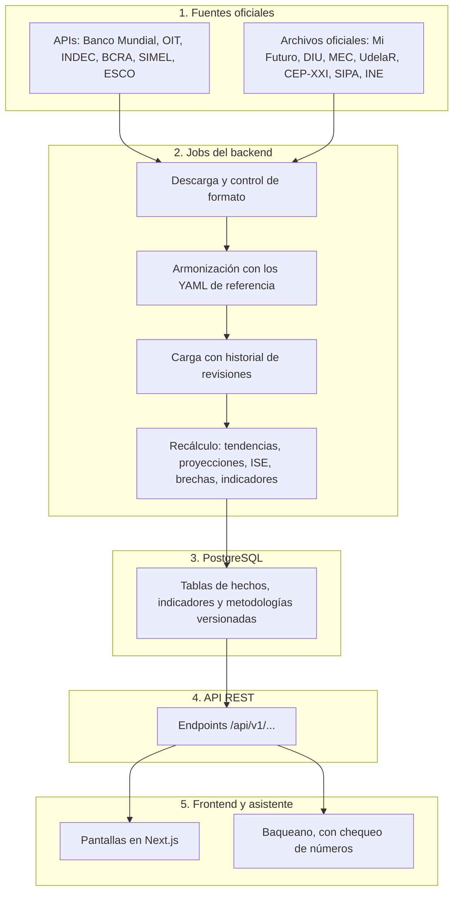

# Observatorio Predictivo de Tendencias · Módulo Data Analytics

**Alcance regional:** Argentina, Uruguay y Chile  
**Programa:** InnovaLab  
**Rol del módulo:** define qué datos usa el observatorio y cómo se analizan: fuentes oficiales, armonización entre países, indicadores, proyecciones y cruces entre formación y ocupación.  
**Norma metodológica:** solo datos oficiales, descargables de forma periódica, sin imputar valores. Lo que se estima o se extiende se dice en pantalla (ver [excepciones](#condiciones-básicas-y-principios-metodológicos)).

> **Qué cambió en noviembre de 2026.** La analítica de este módulo se integró al backend: los datos ya no salen de `pipeline.py` ni de archivos en Drive, sino de jobs que descargan cada fuente oficial. Este README describe lo que la aplicación usa hoy. El código de `data_analytics/` queda como referencia del trabajo original y [la sección 6](#6-funcionalidad-de-los-módulos-del-pipeline) indica qué lo reemplazó.

---

## 1. Visión General del Módulo y Principios Metodológicos

El observatorio integra fuentes oficiales de empleo, salarios, educación superior y series macroeconómicas de **Argentina, Chile y Uruguay**, para analizar cinco sectores estratégicos y sus ocupaciones.

### Condiciones Básicas y Principios Metodológicos:

1. **Solo fuentes oficiales con descarga periódica o API.** Una tabla que no se puede actualizar desde su fuente oficial no entra.
2. **Integrado, no aislado.** Cada fuente tiene un job en el backend que descarga, valida el formato y carga. Si el formato de un archivo cambió, no se carga nada, se conservan los datos anteriores y se genera una alerta.
3. **Paridad internacional:**
   * Los mismos **5 sectores**: *Tecnología, Economía del conocimiento, Salud, Energía y Turismo*.
   * Carreras homologadas con **UNESCO CINE-F 2013**, sectores con **CIIU Rev. 4** y ocupaciones con **OIT CIUO-08**. Las correspondencias de nombres van en YAML (`backend/backend/config/reference/`), nunca en el código.
   * Salarios en **USD** (tipo de cambio oficial) y **USD PPA** (paridad de poder adquisitivo). Los índices usan USD PPA.
4. **Armonización de género:** categorías **F**, **M** y **NB** (no binario, solo Chile). `T` (total) no es una categoría de sexo.
5. **Historial.** No se borra lo anterior: si una fuente corrige un valor, el anterior queda en `data_revisions`.

**Excepciones, siempre declaradas:**

| Qué | Por qué | Dónde se avisa |
|---|---|---|
| LinkedIn (Apify) | No es fuente oficial; se usa solo en Pulso laboral | Pantalla Pulso laboral |
| Matrices de habilidades de este módulo | Las armó el equipo; no tienen descarga oficial | `/analytics/habilidades` |
| Factor PPA de Argentina desde 2022 | El Banco Mundial lo publica hasta 2021; se extiende con la inflación | Metodología y fuentes |
| Salario por ocupación | La OIT lo publica por gran grupo: todas las ocupaciones del grupo muestran el mismo valor | Metodología y fuentes |
| Proyecciones | Son orientativas, no datos | Línea punteada en cada gráfico |

---

## 2. Stack Tecnológico

| Capa / Dominio | Tecnología / Herramienta | Rol |
|---|---|---|
| **Lenguaje base** | Python 3.11+ | Backend, jobs de datos y cálculos |
| **API** | FastAPI, Pydantic | Endpoints y contratos de datos |
| **Base de datos** | PostgreSQL (Supabase), SQLAlchemy, Alembic | Tablas y migraciones |
| **Manipulación de datos** | `pandas`, `numpy` | Limpieza y cruces |
| **Proyecciones** | `statsmodels` | Suavizado exponencial de Holt |
| **Ingesta y APIs** | `httpx`, `apscheduler` | Conexión con APIs y archivos oficiales; actualización programada |
| **Lectura de formatos** | `openpyxl`, `csv`, `zipfile` | `.xlsx`, `.zip` y `.csv` |
| **Configuración** | YAML (`backend/backend/config/`) | Fuentes, metodología, textos y correspondencias |
| **Frontend** | Next.js, TypeScript, Tailwind, Recharts | Pantallas en `backend/frontend_minimal` |
| **Asistente** | Modelo por API compatible con OpenAI (`nvidia/nemotron-3.5-super-vl:free` en OpenRouter) | Baqueano, con chequeo de números |
| **Taxonomías** | UNESCO CINE-F 2013, CIIU Rev. 4 / CLAE2, OIT CIUO-08, ESCO | Homologación internacional |
| **Publicación** | Render (API), Vercel (frontend), Supabase (base) | Producción |
| **Pair programming con IA** | Claude | Desarrollo y revisión |

---

## 3. Arquitectura del Flujo de Datos Extremo a Extremo (Pipeline a Producción)



| Capa | Tecnologías / Módulos | Qué hace | Resultado |
|---|---|---|---|
| **1. Fuentes** | APIs REST y páginas oficiales | Publican los datos | Respuestas JSON y archivos guardados con su huella |
| **2. Jobs** | `app/connectors`, `app/datasets`, `app/ingestion`, `app/analytics` | Descargan, validan, armonizan y calculan | Tablas actualizadas y `data_revisions` |
| **3. Base** | PostgreSQL, Alembic | Guarda datos y metodologías | Migraciones hasta `0031` |
| **4. API** | FastAPI | Expone datos y notas metodológicas | `/api/v1/...` |
| **5. Frontend** | Next.js, Recharts | Muestra los datos y explica su origen | Pantallas y Metodología y fuentes |

### Puntos de Contacto Interdisciplinarios:

* **Data Analytics → Backend:** define fuentes y metodología, que se escriben en `config/` (`sources.yaml`, `analytics.yaml`, `indicators.yaml` y `reference/`).
* **Backend → Frontend:** expone los endpoints documentados en [`backend/docs/guia_api_frontend.md`](../backend/docs/guia_api_frontend.md).
* **Frontend ↔ UX/UI:** implementa las directivas visuales de [la sección 10](#10-especificaciones-de-exposición-para-frontend-y-uxui-consumo-visual).

---

## 4. Inventario Maestro de Fuentes Oficiales (Qué datos se utilizan)

| Ámbito | Organismo | Fuente | Período | Acceso | Qué aporta |
|---|---|---|---|---|---|
| **Argentina** | Depto. de Información Universitaria | Anuarios estadísticos | 2014–2024 | Archivo oficial | Egresados por institución y disciplina; sexo solo para el total del país |
| **Argentina** | Indicadores CTI | Estudiantes y egresados | Según archivo | Archivo oficial | Egresados por disciplina; cubre 2015 y 2019 en las series |
| **Argentina** | CEP-XXI | Puestos, salarios y participación de mujeres por CLAE2 | 2007–nov. 2023 | Archivo oficial | Empleo privado registrado |
| **Argentina** | BCRA | Cotización oficial del dólar (mayorista) | 2007–hoy | API | Conversión mensual de los salarios de CEP-XXI |
| **Argentina** | INDEC | Series de tiempo | Desde dic. 2016 | API | IPC para el salario real; EMAE y EPH |
| **Argentina** | Secretaría de Trabajo | SIPA | Según serie | Archivo oficial | Asalariados registrados por rama |
| **Chile** | SIES / MINEDUC | Mi Futuro, titulados | 2007–2025 | Archivo oficial | Titulados por carrera, institución y sexo (F/M/NB) |
| **Chile** | INE Chile | SIMEL | Según serie | API | Empleo por ocupación |
| **Uruguay** | MEC | Anuario Estadístico de Educación | 2020–2024 | Archivo oficial | Egresados por carrera, institución y sexo |
| **Uruguay** | UdelaR | Serie de egresos de grado | 2000–2024 | Archivo oficial | Egresos por servicio, para las universidades |
| **Uruguay** | INE Uruguay | IPC | Según serie | Archivo oficial | Precios |
| **Supranacional** | OIT, ILOSTAT | Indicadores laborales | Según serie | API | Empleo por sector, ocupación y sexo; salarios en USD y USD PPA |
| **Supranacional** | OIT | Exposición a la IA generativa (2025) | 2025 | Tabla de referencia | Riesgo de automatización del ISE |
| **Supranacional** | Banco Mundial | WDI | Según serie | API | Indicadores socioeconómicos, factor PPA de consumo privado, tipo de cambio e IPC |
| **Supranacional** | Comisión Europea | ESCO | Versión vigente | API | Habilidades de cada ocupación |
| **Supranacional** | O*NET y ESCO | Versiones históricas | Por versión | Archivo / API | Indicador Reina Roja |
| **Mercado laboral** | LinkedIn (Apify) | Ofertas de Argentina; **no oficial** | Oct. 2026 | CSV a mano | 640 avisos para Pulso laboral |

El detalle de cada URL y criterio está en [`backend/docs/fuentes_y_criterios.md`](../backend/docs/fuentes_y_criterios.md). En la aplicación, **Metodología y fuentes** muestra el estado de cada una.

### Lo que dejamos de usar

| Antes | Estado | Motivo o reemplazo |
|---|---|---|
| Descarga manual desde Google Drive | Retirada | Cada archivo se descarga de su página oficial |
| Base SIU-Araucano 2016–2018 | Retirada | Origen sin confirmar. Argentina queda sin sexo por sector |
| Anuarios SPU 2020–2022 | Reemplazados | Anuarios del DIU, 2014–2024 |
| Buscador de Empleabilidad e Ingresos del SIES | Retirado | Sin descarga pública: pide iniciar sesión. Pedido al SIES en pausa |
| Datos Abiertos MEC 2014–2023 | Reemplazados | Anuarios del MEC, que traen institución y sexo |
| ECH del INE Uruguay (empleo por rama y sexo) | Reemplazada | OIT, igual para los tres países |
| Salario mediano de CEP-XXI | No se carga | La tabla usa el salario medio |
| CEPALSTAT | Sin conector | Declarada como fuente, sin datos cargados |
| Factor PPA del PIB (`PA.NUS.PPP`) | Reemplazado | Factor de consumo privado (`PA.NUS.PRVT.PP`), el que usa la OIT |

---

## 5. Guía de Instalación y Ejecución Local Paso a Paso

Ya no hay un entorno propio ni carpetas que armar a mano: todo corre desde el backend. Esta es la versión corta; el detalle está en [`backend/README.md`](../backend/README.md).

### Requisitos Previos del Sistema:
* **Python 3.11 o superior** y **Docker Desktop** (PostgreSQL local).
* Conexión a Internet para descargar las fuentes.

### Paso 1: Posicionarse en el backend
```bash
cd backend/backend
```

### Paso 2: Crear y activar el entorno virtual
```bash
python -m venv .venv
source .venv/bin/activate        # Windows (PowerShell): .venv\Scripts\Activate.ps1
```

### Paso 3: Instalar las dependencias
```bash
pip install -e ".[dev]"
```

### Paso 4: Preparar la configuración y la base
```bash
cp .env.example .env             # completar DATABASE_URL y AUTH_SECRET
docker compose up -d
python -m seeds.load
```
Para crear las tablas en una base vacía, seguí [`backend/docs/despliegue.md`](../backend/docs/despliegue.md).

### Paso 5: Traer los datos
```bash
python -m app.jobs.run --all
```
Para una sola fuente: `python -m app.jobs.run --source <fuente>`. El orden importa en dos casos:

1. `bcra_dolar` va antes de `cep_xxi_argentina`, que usa ese dólar.
2. `universidades_egresados` y `carreras_seguimiento` recalculan los titulados y los indicadores por sector y de género.

### Paso 6: Recalcular
```bash
python -m app.jobs.recompute     # tendencias, proyecciones, ISE, brechas y alertas
```

### Paso 7: Levantar la API y probar
```bash
uvicorn app.main:app --reload --port 8010
pytest
```

### Actualización automática
`python -m app.jobs.scheduler` sigue los horarios de `config/sources.yaml`. **Producción todavía no tiene un programador de tareas:** allí las fuentes se actualizan a mano.

### Matriz de habilidades
Es la única parte que todavía sale de este módulo:
```bash
cd data_analytics
python generar_matriz_habilidades_ia.py
```
La API lee sus CSV desde `backend/data/processed/data_analytics/`: hay que copiarlos ahí después de generarlos.

---

## 6. Funcionalidad de los Módulos del Pipeline

| Módulo original | Estado | Qué lo reemplaza |
|---|---|---|
| `pipeline.py` | No alimenta la aplicación | `python -m app.jobs.run` y `app/ingestion/pipeline.py` |
| `src/ingesta_01.py` | No alimenta la aplicación | `app/connectors/` |
| `src/cleaning_02.py` | No alimenta la aplicación | `app/datasets/`: ver abajo |
| `src/indicadores_03.py` | No alimenta la aplicación | `app/analytics/`: ver abajo |
| `generar_matriz_habilidades_ia.py` | **En uso** | Genera los CSV de `/analytics/habilidades` |
| `backend/seeds/load_analytics.py` | Eliminado | Hacía `TRUNCATE` y cargaba CSV: rompía el historial |
| `fuentes.yaml` | Referencia | `backend/backend/config/sources.yaml` |
| `catalogo_datos_frontend_ux.md` | Desactualizado | `backend/docs/guia_api_frontend.md` |

### Limpieza y armonización (`backend/backend/app/datasets/`)
1. **`universities.py`:** egresados por universidad de los tres países, con los nombres unificados, y rankings.
2. **`tracked_careers.py`:** carreras por institución, temas de seguimiento y sexo. Compara las sumas con los totales que publica cada fuente y frena la carga si se desvían.
3. **`cep_xxi.py`:** puestos, salarios y mujeres por sector, y factores PPA.
4. **`bcra_fx.py`:** dólar oficial diario.

### Indicadores y proyecciones (`backend/backend/app/analytics/`)
1. **`graduate_trends_run.py`:** series por carrera, tendencia y proyección.
2. **`sector_kpis_run.py`:** densidad profesional, empleo, salarios, género y proyección por sector.
3. **`employability_run.py`, `skill_gaps_run.py`:** ISE y brechas de habilidades.
4. **`recompute.py`:** recalcula todo con la metodología vigente y la versiona.

---

## 7. Metodología de Análisis e Indicadores Clave (Cómo se analiza)

### 1. Proyecciones con suavizado de Holt
*Reemplaza a la regresión lineal con intervalos t-Student.* Se usa el mismo método para todos los indicadores, ajustado a cada serie:

$$\hat{Y}_{t+h} = \text{nivel}_t + h \cdot \text{tendencia}_t$$

$$\text{IC} = \hat{Y}_{t+h} \pm 1{,}96 \cdot \sigma \cdot \sqrt{h}$$

* Proyecta **4 períodos**, con al menos **12 valores observados**.
* Los titulados por sector, además, necesitan una serie **sin huecos**. Hoy solo cumple Chile (5 sectores): Argentina y Uruguay no tienen proyección por sector.
* Prolonga la tendencia actual: no anticipa cambios de política ni shocks.

### 2. Tendencias y alertas
*Reemplaza al Z-score de dinamismo sobre titulados.*
* **Tendencia:** regresión lineal sobre los últimos valores; la pendiente relativa supera ±0,02 para contar como crecimiento o disminución.
* **Alerta por cambio atípico:** más de **2 desvíos** de los cambios de la serie, con al menos 5 valores. Solo compara períodos consecutivos.

### 3. Tasa de Densidad Profesional

$$\text{Densidad} = \frac{\text{Graduados anuales}}{\text{Personas ocupadas en el sector (OIT)}} \times 1.000$$

Último dato del total: Chile 25,4 (2025), Argentina 10,9 (2024) y Uruguay 5,3 (2024). Cada país cuenta un nivel distinto de titulados, así que es aproximada.

### 4. Salarios: USD, USD PPA y salario real

| Medida | OIT (ocupaciones y sectores) | Argentina, CEP-XXI |
|---|---|---|
| **USD** | Publicado por la OIT: pesos ÷ tipo de cambio oficial promedio del año | Cada mes ÷ promedio de ese mes del dólar oficial mayorista del BCRA |
| **USD PPA** | Publicado por la OIT: pesos ÷ factor PPA de consumo privado | Salario anual ÷ `PA.NUS.PRVT.PP` (desde 2011; no en 2023) |
| **Salario real** | No aplica | Salario ÷ IPC del INDEC, índice 2017 = 100 (no en 2023) |

**Extrapolación del factor PPA argentino.** El Banco Mundial lo publica hasta 2021. Los valores de la OIT de 2022 a 2024 coinciden con:

$$\text{Factor}_t = \text{Factor}_{t-1} \times \frac{\text{IPC Argentina}_t / \text{IPC Argentina}_{t-1}}{\text{IPC EE. UU.}_t / \text{IPC EE. UU.}_{t-1}}$$

Se dedujo comparando los datos: no sale de documentación de la OIT. El observatorio aplica esa misma regla a CEP-XXI.

### 5. Índice Sintético de Empleabilidad (ISE), versión 0.3
La tasa de inserción **salió del índice**, porque nunca tuvo fuente oficial en los tres países. Las demás dimensiones conservan sus proporciones:

$$\text{ISE} = 0{,}47 \cdot \text{Demanda neta} + 0{,}33 \cdot \text{Salario PPA} - 0{,}20 \cdot \text{Riesgo de automatización}$$

Comparado con la versión 0.2, en 10.464 filas: las mismas ocupaciones tienen puntaje, ningún nivel cambió y la mayor diferencia es 0,00004.

### 6. Matriz de Habilidades y Gradientes de Exposición a IA (OIT WP 140 / 2025)
Sigue vigente en `/analytics/habilidades`: 114 cruces ocupacionales con 4 tipologías (técnicas, emergentes, transversales y digitales) y los gradientes de la OIT.

Las **habilidades por ocupación** que se ven en cada ficha salen de ESCO, que las define como esenciales u opcionales sin puntuarlas. Por eso se muestran con esa etiqueta, sin decimales.

### 7. Género
* **% de mujeres** = F ÷ (F + M + NB). **Brecha** = % de mujeres − % de varones.
* **Brecha salarial** = (salario de varones − salario de mujeres) ÷ salario de varones, sin ajustar por ocupación ni horas.
* **Diagnóstico de paridad:** entre 40 % y 60 % de mujeres (criterio EIGE / OIT de este módulo). Con menos de 30 titulados dice "Pocos casos".

### 8. Rankings de universidades
Top 10 regional en el último año con datos de los tres países (hoy **2024**, antes 2022) y rankings nacionales del último año de cada país (Argentina 2024, Chile 2025 y Uruguay 2024).

---

## 8. Catálogo de Entregables Generados

Los resultados ya no son archivos en `output/`: son **tablas de la base**, que se leen por la API. Las cantidades son de la base local al 5 de noviembre de 2026.

| Tabla | Contenido | Registros |
|---|---|---|
| `hecho_egresados` | Egresados por institución, carrera y sexo | 84.320 |
| `hecho_instituciones_egresados` | Egresados por universidad | 2.703 |
| `graduates` | Titulados oficiales por carrera | 8.080 |
| `graduate_trends`, `graduate_projections` | Tendencia y proyección por carrera | 942 y 992 |
| `hecho_salario` | Salarios de la OIT (620) y CEP-XXI (102) | 722 |
| `hecho_ocupacion_terciarios` | Empleo de la OIT (246) y CEP-XXI (102) | 348 |
| `reporte_densidad_profesional_sector` | Densidad profesional | 144 |
| `analisis_genero_integral` | Indicadores de género | 154 |
| `proyecciones_graduados_sector` | Proyección de titulados por sector | 20 |
| `ranking_universidades_regional`, `ranking_universidades_nacional` | Rankings | 10 y 27 |
| `factores_macro_ppa` | Factor PPA, tipo de cambio e IPC | 195 |
| `tipo_cambio_diario` | Dólar oficial del BCRA | 4.852 |
| `observations` | Series de los 29 indicadores | 77.817 |
| `employability_scores` | ISE, versiones 0.2 y 0.3 | 20.928 |
| `occupation_skills`, `esco_occupations` | Habilidades y ocupaciones ESCO | 133.122 y 1.701 |
| `job_postings` | Ofertas de LinkedIn | 640 |

**Archivos que siguen en uso** (`backend/data/processed/data_analytics/`): `matriz_habilidades_sectoriales_integrales.csv` y `matriz_habilidades_riesgo_ia_sector.csv`.

**Lo que dejamos de generar:**

| Entregable | Motivo |
|---|---|
| `indicadores_interanuales_zscore.csv` | Lo reemplazan las alertas |
| Semáforo presupuestario (`ALTA`, `MEDIA`, `BAJA`) | Sin uso en la aplicación |
| `reporte_brecha_salarial_regional.csv`, `reporte_salarios_detalle_local.csv` | Lo reemplazan `/analytics/sectores` y `/analytics/salarios/dual` |
| `reporte_brechas_genero_detallado.csv` | Lo reemplaza la pestaña Género |
| `informe_cobertura.csv` y la tabla `coverage_report` | Retirados |
| `resumen_ingesta.csv` | Lo reemplazan `ingestion_runs` y la pantalla de fuentes |
| Gráficos PNG en `output/graficos/` | Los gráficos se dibujan en la aplicación |

Las tablas `dim_pais`, `dim_sector`, `dim_carrera`, `dim_sexo` y `dim_tiempo` siguen creadas, pero vacías: se conservan por si el equipo las necesita.

---

## 9. Especificaciones de Integración con Backend (Traspaso y Persistencia)

### De los CSV a las tablas de hoy

| Archivo original | Tabla | Quién la carga ahora |
|---|---|---|
| `hecho_egresados.csv` | `hecho_egresados` | `carreras_seguimiento` |
| `hecho_instituciones_egresados.csv` | `hecho_instituciones_egresados` | `universidades_egresados` |
| `ranking_universidades_*.csv` | `ranking_universidades_*` | `universidades_egresados` |
| `hecho_salario.csv` | `hecho_salario` | `recompute_sector_tables` (OIT) y `cep_xxi_argentina` (CEP-XXI) |
| `hecho_ocupacion_terciarios.csv` | `hecho_ocupacion_terciarios` | `recompute_sector_tables` (OIT) y `cep_xxi_argentina` (CEP-XXI) |
| `factores_macro_ppa.csv` | `factores_macro_ppa` | `cep_xxi_argentina` |
| `reporte_densidad_profesional_sector.csv` | `reporte_densidad_profesional_sector` | `recompute_sector_tables` |
| `analisis_genero_integral.csv` | `analisis_genero_integral` | `recompute_sector_tables` |
| `proyecciones_graduados_sector.csv` | `proyecciones_graduados_sector` | `recompute_sector_tables` |

Los datos de las fuentes registran sus cambios en `data_revisions`. Las tablas derivadas se recalculan desde esos datos, así que se pueden volver a generar.

### Endpoints REST analíticos

| Endpoint | Para qué |
|---|---|
| `GET /api/v1/analytics/sectores` | Indicadores por sector, género, proyecciones y CEP-XXI |
| `GET /api/v1/analytics/densidad-profesional` | Densidad profesional, con `enfoque` |
| `GET /api/v1/analytics/salarios/dual` | Salarios, con `enfoque` `local` (CEP-XXI) o `regional` (OIT) |
| `GET /api/v1/analytics/habilidades` (y `/habilidades-ia`) | Matriz de habilidades |
| `GET /api/v1/graduates/...` | Titulados, tendencias, instituciones y rankings |
| `GET /api/v1/sources/notes` | Cómo se calcula cada salario e indicador de género |

`GET /api/v1/analytics/ise/metodologia-insercion` se **retiró** junto con la tasa de inserción.

---

## 10. Especificaciones de Exposición para Frontend y UX/UI (Consumo Visual)

El contrato de la API está en [`backend/docs/guia_api_frontend.md`](../backend/docs/guia_api_frontend.md).

### Dónde se ve cada cosa

| Sección | Pestañas |
|---|---|
| **Panorama** | Indicadores · Brecha generacional · Ocupaciones en movimiento |
| **Empleo y habilidades** | Sectores · Ocupaciones · Brechas de habilidades · Titulados y proyecciones · Indicadores por sector · Género |
| **Pulso laboral** | Ofertas de LinkedIn |
| **Experimental** | Moctezuma · Ludita · Reina Roja · Sísifo |
| **Metodología y fuentes** | Métodos, indicadores y fuentes |

### 1. Gráficos de proyecciones
* **Serie observada:** línea continua.
* **Proyección:** línea punteada, con su intervalo al elegir un país.
* Un indicador sin tendencia muestra solo la serie observada.

### 2. Cada país con su último dato
Las tablas muestran el último año de cada país y lo indican. El top 10 regional usa el último año común.

### 3. Principio anti-alucinación
* **No inventar datos:** sin dato oficial, la celda muestra "—".
* **El asistente solo usa números verificables:** cada número de la respuesta tiene que aparecer en los datos consultados; si no, la respuesta se bloquea.
* **Lo de afuera se separa:** para los indicadores experimentales, Baqueano puede consultar Wikipedia, y lo cita como fuente externa.
* **Años parciales:** 2023 de CEP-XXI muestra 11 meses y no recibe factores anuales.

---

## 11. Estructura de Directorios del Módulo

Cómo queda el repositorio, con lo que usa la aplicación:

```text
backend/
├── backend/
│   ├── app/
│   │   ├── connectors/          <- APIs oficiales
│   │   ├── datasets/            <- Archivos oficiales, universidades, carreras, CEP-XXI, BCRA
│   │   ├── ingestion/           <- Jobs de actualización e historial de revisiones
│   │   ├── analytics/           <- Tendencias, proyecciones, ISE, brechas, sectores, género
│   │   ├── assistant/           <- Baqueano
│   │   └── api/v1/              <- Endpoints
│   ├── config/
│   │   ├── sources.yaml         <- Fuentes, URLs y horarios
│   │   ├── indicators.yaml      <- Indicadores y sus series
│   │   ├── analytics.yaml       <- Metodología
│   │   └── reference/           <- Correspondencias de carreras, sectores y universidades
│   └── migrations/              <- Alembic, hasta 0031
├── data/
│   ├── raw/                     <- Archivos oficiales descargados (no van a git) y LinkedIn
│   ├── processed/data_analytics/ <- Matrices de habilidades
│   └── scripts/                 <- Referencias y preparación
├── frontend_minimal/            <- Frontend publicado
└── docs/                        <- Fuentes y criterios, guía de la API, despliegue

data_analytics/                  <- Trabajo original de este módulo
├── generar_matriz_habilidades_ia.py  <- En uso
├── pipeline.py, src/            <- Referencia: ya no alimentan la aplicación
├── fuentes.yaml                 <- Referencia
├── catalogo_datos_frontend_ux.md <- Desactualizado
└── README.md                    <- Este archivo
```

---

## 12. Diccionario de Datos y Glosario Metodológico

| Campo / Concepto | Tipo | Definición |
|---|---|---|
| **cine_f** | Clasificador | Campo de estudio UNESCO CINE-F 2013; ubica cada carrera en un sector |
| **isic_codes** | Clasificador | Divisiones CIIU Rev. 4 de cada sector (`catalog.yaml`) |
| **ciuo_08** | Clasificador | Ocupación de la OIT, a 4 dígitos |
| **share_mujeres** | Métrica | % de mujeres ocupadas del sector (OIT o CEP-XXI) |
| **graduados_por_mil_ocupados** | Métrica | Densidad profesional |
| **brecha_graduados_pct** | Métrica | % de mujeres − % de varones entre titulados |
| **brecha_empleo_pct** | Métrica | % de mujeres − % de varones entre ocupados |
| **brecha_salarial_pct** | Métrica | Cuánto menos ganan las mujeres que los varones |
| **diagnostico_paridad** | Etiqueta | Zona de paridad, concentración femenina, subrepresentación femenina o pocos casos |
| **salario_usd** | Moneda | CEP-XXI convertido mes a mes con el dólar del BCRA |
| **salario_usd_ppa** | Moneda | Salario en dólares de paridad, con factor de consumo privado |
| **factor_ppa** | Factor | `PA.NUS.PRVT.PP`; `metodo_ppa` indica si fue extendido |
| **tipo_cambio** | Factor | Tipo de cambio oficial anual (`PA.NUS.FCRF`) |
| **ipc_base_2016** | Índice | IPC con 2016 = 100; vacío para Argentina, cuyo IPC empieza en diciembre de 2016 |
| **indice_real** | Índice | Salario real de CEP-XXI, 2017 = 100 |
| **meses_observados** | Metadato | Meses con dato en el año; 11 en 2023 |
| **position** | Métrica | Puesto de la ocupación entre las del país |
| **relation** | Etiqueta | Esencial u opcional, según ESCO |
| **categoria_genero** | Clasificación | `F`, `M` y `NB`; `T` es el total de control |

---

## 13. Bitácora de Auditoría y Verificaciones Técnicas

### Trabajo original del módulo (Noelia Acuña)
Las decisiones metodológicas de estas etapas siguen siendo la base del observatorio:

* **Tanda 1:** supresión de series simuladas y adopción de `NaN` en celdas no observadas.
* **Tanda 2:** limpieza de acentos, nombres institucionales y mapeo de carreras.
* **Tanda 3:** factores PPA e ingreso al primer año de SIES.
* **Tanda 4:** armonización multipaís y control de años consecutivos.
* **Tanda 5:** verificación del pipeline de punta a punta.
* **Etapas de integración 1 a 5:** paridad regional, carga en SQL, densidad profesional, correspondencias CIUO-08 y matriz de habilidades.

### Tanda 6: Integración en el backend (noviembre de 2026)
* **Fuentes oficiales:** cada tabla se alimenta de su descarga oficial, con control de formato e historial.
* **Series de Argentina:** anuarios del DIU, con CTI en 2015 y 2019. El archivo CTI queda entre 17 % y 19 % por debajo de los anuarios en 2016–2018 y 2021.
* **CEP-XXI:** archivos oficiales idénticos byte a byte a tres de los usados por el módulo original.
* **ISE 0.3:** salió la tasa de inserción, sin cambios de nivel.
* **Salarios:** se comprobó que el tipo de cambio de la OIT coincide con el del Banco Mundial en 11 países-año (2021–2024) y, en Argentina, en 17 grupos de ocupación durante 16 años. El promedio anual del dólar del BCRA queda a menos de 1 % en los 19 años de 2007 a 2025. Ejemplo: $ 957.135 ÷ 1.240,85 = USD 771.
* **PPA:** corregido a consumo privado en CEP-XXI; el factor del PIB daba cerca de 10 % de más.
* **Género:** indicadores llevados a su propia pestaña, con el rango de 40 % a 60 %.
* **Verificación:** 274 tests, `ruff`, `tsc` y `next build`; Baqueano probado con el modelo real.

### Pendiente
* Elegir el programador de tareas de producción.
* Confirmar el criterio EIGE / OIT del rango de paridad.
* Revisar las correspondencias marcadas `review` en `config/reference/`.
* Decidir si el Buscador del SIES se retoma y si las tablas `dim_*` siguen.
