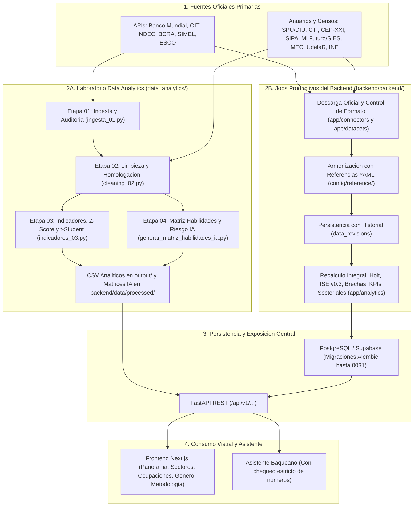
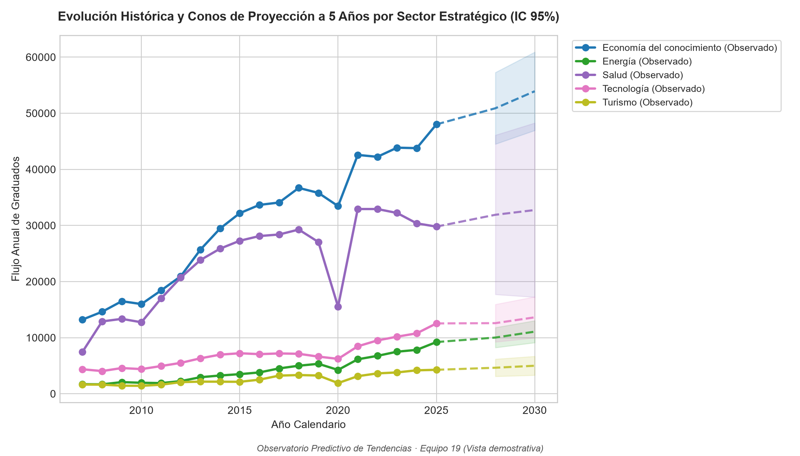
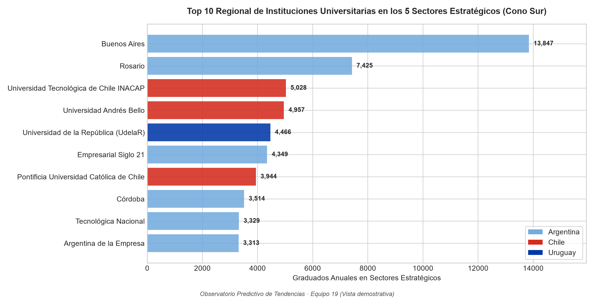
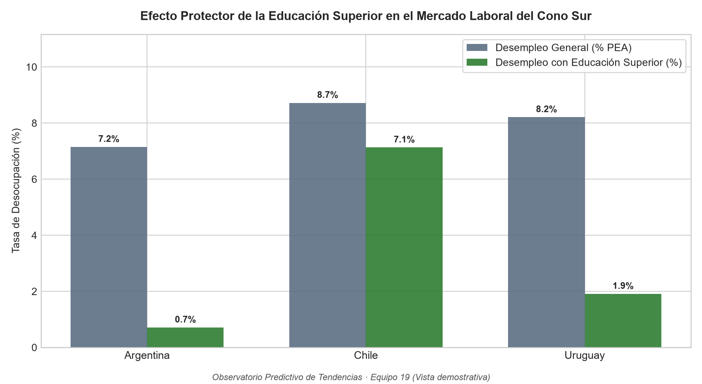

# Observatorio Predictivo de Tendencias · Módulo Data Analytics

**Alcance Regional:** Argentina, Uruguay y Chile  
**Programa:** InnovaLab  
**Rol del Módulo:** Diseño metodológico, ingesta, limpieza, armonización multipaís, cálculo de indicadores estadísticos, proyecciones de tendencias socioeconómicas, laborales y educativas, y articulación formativa-ocupacional con impacto de Inteligencia Artificial.  
**Norma Metodológica:** 100% Datos Observados Oficiales (Cero imputaciones sintéticas, estimaciones figuradas ni sustituciones artificiales). Todo lo que se proyecta o extiende se declara de forma explícita en pantalla.

> [!NOTE]
> **Arquitectura Dual del Módulo (Laboratorio Analítico + Producción en Backend):**  
> Este módulo (`data_analytics/`) constituye el **Laboratorio Científico de Analítica de Datos, Motor de Homologación Multipaís y Generador Activo de la Matriz de Habilidades e IA** del Observatorio. A partir de noviembre de 2026, sus reglas metodológicas, diccionarios de armonización y modelos se encuentran además **integrados de forma nativa y automatizada en el Backend Central (`backend/backend/`)**, donde jobs periódicos descargan cada fuente oficial, validan su estructura, registran el historial en `data_revisions` y sirven los indicadores vía API REST.  
> Este documento unifica y documenta **ambas capas en coexistencia**: tanto el pipeline científico autónomo de `data_analytics/` (`pipeline.py`, `src/`, `generar_matriz_habilidades_ia.py`) como la arquitectura de ejecución continua que hoy alimenta a la aplicación en producción.

---

## 1. Visión General del Módulo y Principios Metodológicos

El **Observatorio Predictivo de Tendencias** integra fuentes oficiales de empleo, salarios, educación superior y series macroeconómicas de **Argentina, Chile y Uruguay** para normalizarlas y producir métricas comparables en cinco sectores estratégicos y sus ocupaciones: modelos de tendencia y proyección con intervalos de confianza al 95%, tasas de densidad profesional, Índice Sintético de Empleabilidad (ISE), diagnósticos tridimensionales de género, rankings institucionales universitarios y matrices de habilidades frente a la transformación tecnológica e Inteligencia Artificial.

### Condiciones Básicas y Principios Metodológicos:

1. **100% Datos Observados y Fuentes Oficiales Auditables:** No se aplican sustituciones sintéticas, datos inventados ni imputaciones artificiales. Cada dato proviene directamente de fuentes y relevamientos oficiales de ministerios, organismos estadísticos nacionales y agencias supranacionales con descarga periódica o API pública.
2. **Coexistencia Operativa (Aislamiento en Laboratorio + Integración en Producción):**
   * En el **Laboratorio Analítico (`data_analytics/`)**, el pipeline opera de forma autónoma para experimentación, auditoría estadística, generación de reportes CSV/PNG y construcción de las matrices de habilidades e IA (`generar_matriz_habilidades_ia.py`).
   * En el **Backend Productivo (`backend/backend/`)**, cada fuente cuenta con un job automatizado que descarga, valida el formato y persiste en PostgreSQL. Si el formato de un archivo oficial cambia, la carga se detiene preventivamente, se conservan los datos anteriores y se emite una alerta.
3. **Paridad Internacional Tripartita:**
   * Comparación estricta de los mismos **5 sectores estratégicos**: *Tecnología, Economía del conocimiento, Salud, Energía y Turismo*.
   * Homologación de carreras y disciplinas según clasificaciones internacionales estándar (**UNESCO CINE-F 2013 / UNSD CIIU Rev. 4 / OIT CIUO-08 / ESCO**). En el backend, las tablas de correspondencia se parametrizan en archivos YAML (`backend/backend/config/reference/`), desacopladas del código.
   * Conversión de salarios en moneda local (ARS, CLP, UYU) a **USD** (tipo de cambio oficial) y **USD PPA (Paridad de Poder Adquisitivo)** utilizando factores del Banco Mundial y deflactores de IPC.
4. **Armonización de Género bajo Estándar EIGE / OIT:** Estandarización de categorías en **F** (femenino), **M** (masculino) y **NB** (no binario / indefinido, reportado oficialmente en Chile). La etiqueta `T` (total) se utiliza exclusivamente como totalizador de control y nunca como categoría de género. El diagnóstico de paridad aplica el umbral internacional **40%–60%** (EIGE/OIT).
5. **Trazabilidad Histórica Inmutable:** En la base de datos productiva no se sobrescribe ni elimina evidencia previa; si un organismo oficial corrige o actualiza retrospectivamente un valor, el registro anterior se preserva en la tabla `data_revisions`.
6. **Auditoría e Inspección Continua con Agentes de IA en Google Antigravity:** El diseño metodológico, la depuración del código del pipeline, la inspección de consistencia matemática, el filtrado semántico de ocupaciones CIUO-08 y la validación de paridad regional se desarrollaron mediante *pair programming* en **Google Antigravity IDE**, apoyándose en **Claude AI** y **Gemini 4 Argon (Medium)** para realizar revisiones exhaustivas paso a paso, trazabilidad en bitácoras y pruebas de estrés algorítmico.

### Excepciones Metodológicas (Siempre Declaradas en Interfaz):

| Excepción / Caso | Fundamento Metodológico | Dónde se informa al usuario |
|---|---|---|
| **Ofertas de LinkedIn (Apify)** | Relevamiento observacional de mercado; no es una fuente estadística estatal. Se utiliza exclusivamente para monitorear demanda viva de habilidades. | Pantalla *Pulso laboral* y metadatos de `/analytics/habilidades` |
| **Matrices de Habilidades e IA (`data_analytics`)** | Elaboradas por el equipo de Data Analytics articulando taxonomías oficiales (CIUO-08, CINE-F, ESCO y OIT WP 140). | Endpoint `/api/v1/analytics/habilidades` y sección *Empleo y habilidades* |
| **Factor PPA de Argentina desde 2022** | El Banco Mundial publica el factor observado de Argentina hasta 2021; de 2022 en adelante se extiende por diferencial de inflación, replicando el criterio implícito de ILOSTAT. | Sección *Metodología y fuentes* y notas de `/api/v1/sources/notes` |
| **Salario OIT por Ocupación** | ILOSTAT reporta ingresos por gran grupo ocupacional (1 dígito CIUO-08); todas las ocupaciones de 4 dígitos dentro de un mismo gran grupo reflejan ese valor de referencia. | Sección *Metodología y fuentes* |
| **Proyecciones Estadísticas** | Constituyen estimaciones orientativas basadas en la tendencia histórica observada, no hechos censales futuros. | Serie en línea punteada con banda de confianza al 95% en cada gráfico |

---

## 2. Stack Tecnológico (Laboratorio de Datos + Producción)

El ecosistema tecnológico combina librerías científicas de Python para el modelado y depuración en `data_analytics/` con una arquitectura moderna de servicios en `backend/` y `frontend_minimal/`:

| Capa / Dominio | Tecnología / Herramienta | Rol y Función en el Sistema |
|---|---|---|
| **Lenguaje Base** | Python 3.11+ (validado hasta 3.15) | Núcleo del pipeline científico en `data_analytics/`, jobs de ingesta y motor de cálculo en `backend/`. |
| **Manipulación y Cálculo** | `pandas` (>= 2.2.0), `numpy` (>= 1.26.0) | Limpieza, estructuración tabular, cruces dimensionales, agregaciones vectorizadas y gestión estricta de `NaN`. |
| **Modelado Estadístico y Proyecciones** | `scipy` (>= 1.12.0), `statsmodels` | Regresiones lineales con intervalos $t$-Student al 95% y Z-scores en laboratorio (`scipy`); suavizado exponencial de Holt en producción (`statsmodels`). |
| **Ingesta, APIs y Programación** | `requests`, `httpx`, `apscheduler` | Consumo de APIs REST oficiales (Banco Mundial, OIT, INDEC, BCRA, SIMEL, ESCO) y ejecución programada de jobs. |
| **Lectura de Formatos Oficiales** | `openpyxl`, `odfpy`, `csv`, `zipfile` | Extracción automatizada de censos y anuarios en `.xlsx`, `.ods`, `.zip` y `.csv` (RFC 4180 / UTF-8). |
| **Visualización Científica y UI** | `matplotlib` (>= 3.8.0) / Next.js, TypeScript, Tailwind, Recharts | Generación de gráficos estáticos de alta resolución (300 DPI) en `data_analytics/` y dashboards interactivos en la web. |
| **API y Persistencia** | FastAPI, Pydantic, PostgreSQL (Supabase), SQLAlchemy, Alembic | Exposición de contratos JSON validados, persistencia relacional, control de revisiones (`data_revisions`) y migraciones (hasta `0031`). |
| **Configuración Declarativa** | YAML (`fuentes.yaml` y `backend/backend/config/`) | Parametrización de fuentes, indicadores, reglas metodológicas y tablas de referencia sin valores hardcodeados. |
| **Asistente Verificado** | API compatible con OpenAI (`nvidia/nemotron-3.5-super-vl:free` / Ollama / Claude) | Asistente **Baqueano** con verificación determinista de cifras contra la base de datos. |
| **Taxonomías Internacionales** | UNESCO CINE-F 2013, UNSD CIIU Rev. 4 / CLAE2, OIT CIUO-08, ESCO, OIT WP 140 | Estándares internacionales para homologar carreras, sectores, ocupaciones, competencias e impacto de IA. |
| **Entornos de Desarrollo (IDE)** | Google Antigravity IDE, Visual Studio Code | Entorno de desarrollo agéntico, inspección de terminales, ejecución de pipelines y control de calidad. |
| **Pair Programming con IA** | **Claude AI** y **Gemini 4 Argon (Medium)** en Google Antigravity | Auditoría metodológica, refactorización modular, depuración semántica de matrices CIUO-08, pruebas de estrés algorítmico y consistencia matemática. |
| **Despliegue y Versionado** | Git / GitHub, Render (API), Vercel (Frontend), Supabase (PostgreSQL), Google Drive | Control de versiones colaborativo, resguardo de datasets crudos y despliegue cloud continuo. |

---

## 3. Arquitectura del Flujo de Datos Extremo a Extremo (Laboratorio a Producción)

El Observatorio articula el flujo de investigación y generación de matrices de `data_analytics/` con el flujo transaccional continuo de `backend/`:



| Capa del Sistema | Módulos y Componentes | Procesamiento Realizado | Salidas Generadas |
|---|---|---|---|
| **1. Fuentes Oficiales** | APIs REST + Portales Estadísticos | Publicación de series de ARG, CHL y URY (SPU/DIU, CEP-XXI, INDEC, BCRA, SIES/Mi Futuro, MEC, UdelaR, BM, OIT, ESCO). | JSON directo y archivos oficiales validados con hash SHA-256. |
| **2A. Laboratorio `data_analytics/`** | `ingesta_01.py`, `cleaning_02.py`, `indicadores_03.py`, `generar_matriz_habilidades_ia.py` | Homologación CINE-F/CIIU/CIUO-08, USD PPA, Z-scores ($|Z| \ge 1{,}4$), regresiones $t$-Student 95%, diagnóstico de género y curaduría de 114 cruces formativo-ocupacionales con riesgo IA (OIT WP 140). | 16 tablas CSV en `output/`, visualizaciones PNG y las 2 matrices de habilidades e IA consumidas por el backend. |
| **2B. Jobs `backend/backend/`** | `app/connectors`, `app/datasets`, `app/ingestion`, `app/analytics` | Descarga programada, validación de esquemas, cruce con `config/reference/*.yaml`, suavizado de Holt, ISE v0.3 e indicadores experimentales. | Tablas relacionales actualizadas e historial de auditoría en `data_revisions`. |
| **3. Base de Datos y API** | PostgreSQL, SQLAlchemy, Alembic (`0031`), FastAPI | Almacenamiento transaccional de hechos, dimensiones, observaciones y exposición de endpoints REST documentados. | Endpoints `/api/v1/analytics/...`, `/api/v1/graduates/...`, `/api/v1/employability/...`. |
| **4. Frontend y UX/UI** | Next.js, TypeScript, Tailwind, Recharts, Baqueano | Representación interactiva con directivas anti-alucinación, notas metodológicas por indicador y asistente conversacional verificado. | Pantallas de usuario final y módulo *Metodología y fuentes*. |

### Puntos de Contacto Interdisciplinarios:

* **Data Analytics $\rightarrow$ Backend:** Define las fuentes oficiales, las reglas de armonización multipaís, los umbrales estadísticos (criterio EIGE/OIT 40%–60% y gradientes OIT WP 140) y provee directamente los CSV de matrices de habilidades e IA en `backend/data/processed/data_analytics/`.
* **Backend $\rightarrow$ Frontend:** Expone los endpoints REST bajo esquemas Pydantic documentados en [`backend/docs/guia_api_frontend.md`](file:///c:/proyectos/observa_tendencias/backend/docs/guia_api_frontend.md).
* **Data Analytics + Backend $\rightarrow$ UX/UI & Frontend:** Proveen los lineamientos visuales y el Manual Metodológico de Indicadores para que cada pantalla explique con transparencia cómo se calcula e interpreta cada métrica.

---

## 4. Inventario Maestro de Fuentes Oficiales (Qué datos se utilizan)

El Observatorio utiliza exclusivamente fuentes primarias auditadas de Argentina, Chile, Uruguay y organismos internacionales:

| Ámbito | Organismo | Fuente / Relevamiento | Período Observado | Acceso / Formato | Indicadores Clave Obtenidos |
|---|---|---|---|---|---|
| **Argentina** | SPU / DIU (Min. Capital Humano) | Anuarios Estadísticos Universitarios (`2012–2024`) y Serie SPU (`2014–2023`) | 2012–2024 (Anuarios DIU/SPU), 2014–2023 (Serie SPU) | Archivo oficial `.zip` / `.csv` / `.xlsx` | Egresados universitarios por institución, carrera/disciplina y total nacional por sexo (`F`/`M`). |
| **Argentina** | Indicadores CTI | Base de Estudiantes y Egresados Universitarios | 2015 y 2019 (complemento de serie) | Archivo oficial `.csv` | Egresados por disciplina para cubrir años específicos en series del backend. |
| **Argentina** | CEP-XXI (Min. Economía) | Series de Puestos, Salarios y Participación Femenina por CLAE2 | 2007–nov. 2023 (11 meses en 2023) | Archivo oficial `.csv` | Empleo privado formal registrado, salarios medios/medianos y % de mujeres por rama. |
| **Argentina** | BCRA | Estadísticas Cambiarias (Dólar Oficial Mayorista) | 2007–actualidad | API REST oficial | Conversión mensual exacta de salarios nominales de CEP-XXI a USD. |
| **Argentina** | INDEC | API Oficial de Series de Tiempo | Dic. 2016–actualidad | API REST JSON | IPC Nacional para deflación de salario real, EMAE y tasas EPH. |
| **Argentina** | Secretaría de Trabajo | SIPA (Sistema Integrado Previsional Argentino) | Serie histórica vigente | Archivo oficial | Asalariados registrados por rama de actividad. |
| **Chile** | SIES / MINEDUC | Base Histórica de Titulados Mi Futuro y Estadísticas por Carrera SIES | 2007–2025 | Archivo oficial `.xlsx` | Titulados por carrera, institución, nivel y sexo (`F`/`M`/`NB`); ingresos y empleabilidad en laboratorio. |
| **Chile** | INE Chile | SIMEL (Sistema de Información del Mercado Laboral) | Serie vigente | API REST oficial | Empleo formal desagregado por ocupación. |
| **Uruguay** | MEC (Div. Estadística) | Anuarios Estadísticos de Educación | 2020–2024 | Archivo oficial `.xlsx` | Egresados universitarios por carrera, institución (UdelaR, UTEC y privadas) y sexo (`F`/`M`). |
| **Uruguay** | UdelaR (DGPlaneamiento) | Serie Histórica de Egresos de Grado por Servicio | 2000–2024 | Archivo oficial `.ods` | Egresos totales de grado por facultad/servicio (fuente principal para UdelaR). |
| **Uruguay** | INE Uruguay | Índice de Precios del Consumo (IPC) y ECH | Serie vigente | Archivo oficial `.csv` / `.xlsx` | Evolución de precios para deflación y distribución de empleo. |
| **Supranacional** | OIT (ILOSTAT) | Indicadores Laborales SDMX/API | 2011–2024 | API REST CSV/SDMX | Empleo por sector y sexo, ocupados con Educación Superior y salarios en moneda local, USD y USD PPA. |
| **Supranacional** | OIT (Research Dept.) | Working Paper 140 (Gmyrek et al., 2025): GenAI & Jobs | 2025 | Tabla oficial de referencia | Exposición media, desvío estándar y gradientes de transformación por IA generativa para 427 ocupaciones CIUO-08. |
| **Supranacional** | Banco Mundial (WDI) | World Development Indicators API | 2010–2025 | API REST JSON | Factores PPA de consumo privado y PIB, tipo de cambio oficial, IPC y tasas de desempleo. |
| **Supranacional** | Comisión Europea / EE. UU. | Clasificador ESCO y O*NET | Versiones históricas y actual | API REST / Archivos | Competencias esenciales y opcionales por ocupación e insumos para el indicador *Reina Roja*. |
| **Mercado Laboral** | Observatorio / LinkedIn | Relevamiento de Ofertas Laborales Cono Sur (Apify) | 2024–2026 | CSV (Muestra observada) | 640 publicaciones de empleo reales para monitoreo de demanda y validación de habilidades. |

El detalle exhaustivo de URLs y validaciones de producción se encuentra en [`backend/docs/fuentes_y_criterios.md`](file:///c:/proyectos/observa_tendencias/backend/docs/fuentes_y_criterios.md) y en [`data_analytics/fuentes.yaml`](file:///c:/proyectos/observa_tendencias/data_analytics/fuentes.yaml).

---

## 5. Guía de Instalación y Ejecución Local Paso a Paso

Dependiendo de tu objetivo, puedes ejecutar el **Pipeline Científico Autónomo de `data_analytics/`** (para regenerar las matrices de habilidades e IA, auditar la limpieza o exportar los CSV y gráficos estáticos) o levantar el **Entorno Completo del Backend (`backend/backend/`)**.

### 5.A. Ejecución del Pipeline Científico Autónomo (`data_analytics/`)

#### Paso 1: Posicionarse en el directorio del módulo y activar entorno virtual
```bash
cd c:/proyectos/observa_tendencias/data_analytics

# Crear entorno virtual:
python -m venv .venv

# Activar en Windows (PowerShell):
.venv\Scripts\Activate.ps1
# (En Linux / macOS / Git Bash: source .venv/bin/activate)

# Instalar dependencias:
pip install --upgrade pip
pip install -r requirements.txt
```

#### Paso 2: Estructura de carpetas `data/raw/` (para corrida de las Etapas 1 a 3)
```bash
New-Item -ItemType Directory -Force -Path "data/raw/argentina", "data/raw/chile", "data/raw/uruguay", "data/raw/linkedin_jobs"
```
Ubicando en cada subcarpeta los anuarios y series oficiales correspondientes a Argentina (SPU/DIU y CEP-XXI), Chile (Mi Futuro y SIES) y Uruguay (Anuarios MEC y UdelaR).

#### Paso 3: Ejecución por etapas o integral del Pipeline
```bash
# Etapa 01: Ingesta de APIs (BM, OIT, CEPAL, INDEC) y extraccion de ZIPs
python pipeline.py --etapa 1

# Etapa 02: Limpieza, homologacion CINE-F/CIIU y modelo dimensional (--force reconstruye caches)
python pipeline.py --etapa 2 --force

# Etapa 03: Indicadores, Z-scores, proyecciones t-Student, genero y graficos PNG
python pipeline.py --etapa 3

# Etapa 04: Generacion de la Matriz Integral de Habilidades y Riesgo IA (En uso directo por Backend)
python generar_matriz_habilidades_ia.py
```

---

### 5.B. Ejecución Integrada en el Backend Central (`backend/backend/`)

```bash
# 1. Posicionarse en el backend y crear entorno virtual
cd c:/proyectos/observa_tendencias/backend/backend
python -m venv .venv
.venv\Scripts\Activate.ps1
pip install -e ".[dev]"

# 2. Configurar variables de entorno y levantar PostgreSQL en Docker
copy .env.example .env           # Completar DATABASE_URL y AUTH_SECRET
docker compose up -d
alembic upgrade head
python -m seeds.load

# 3. Descargar y procesar las fuentes oficiales
python -m app.jobs.run --all

# 4. Recalcular tendencias, proyecciones (Holt), ISE v0.3, brechas, KPIs sectoriales y alertas
python -m app.jobs.recompute

# 5. Levantar el servidor FastAPI y ejecutar la suite de tests (274+ tests)
uvicorn app.main:app --reload --port 8010
pytest
```

---

## 6. Funcionalidad de los Módulos y Trazabilidad con el Backend

| Módulo en `data_analytics/` | Función en el Laboratorio Analítico | Contraparte Productiva en `backend/backend/` | Estado en la Aplicación |
|---|---|---|---|
| `generar_matriz_habilidades_ia.py` | Articula las 25 carreras objetivo con 54 ocupaciones CIUO-08, 4 tipologías de competencias, taxonomía ESCO y exposición a IA (OIT WP 140). | Consumido directamente por `app/api/v1/analytics.py` desde `backend/data/processed/data_analytics/`. | **Activo en producción** (`/api/v1/analytics/habilidades` y `/habilidades-ia`). |
| `src/ingesta_01.py` | Descarga series de Banco Mundial, CEPALSTAT, ILOSTAT e INDEC, descomprime anuarios y audita integridad. | `app/connectors/` y `app/ingestion/pipeline.py` (con control de formato e historial en `ingestion_runs`). | Automatizado vía jobs del backend. |
| `src/cleaning_02.py` | Normaliza carreras bajo CINE-F 2013 y sectores CIIU Rev. 4; procesa series universitarias y salariales de ARG, CHL y URY en USD PPA. | `app/datasets/universities.py`, `tracked_careers.py`, `cep_xxi.py`, `bcra_fx.py` y diccionarios en `config/reference/*.yaml`. | Automatizado y versionado en tablas SQL con `data_revisions`. |
| `src/indicadores_03.py` | Calcula variaciones interanuales con control de consecutividad, Z-scores, proyecciones $t$-Student al 95%, densidad profesional, brechas salariales, diagnóstico de género (EIGE/OIT 40–60%) y gráficos PNG. | `app/analytics/graduate_trends_run.py`, `sector_kpis_run.py`, `employability_run.py`, `skill_gaps_run.py` y `recompute.py`. | Automatizado en el motor de recálculo del backend. |
| `fuentes.yaml` | Inventario estructurado de fuentes oficiales, cobertura y metadatos del módulo. | `backend/backend/config/sources.yaml` e `indicators.yaml`. | Unificado en la configuración YAML del backend. |

---

## 7. Síntesis Metodológica de Indicadores (Guía Rápida de Lectura)

> *Esta sección resume los lineamientos metodológicos principales del Observatorio. La especificación matemática detallada de cada dimensión y el manual de usuario extendido forman parte de la documentación integral de la plataforma.*

### 1. Modelado Predictivo y Conos de Incertidumbre (IC 95%)
* **En Producción (Suavizado Exponencial de Holt):** Proyecta un horizonte de 4 períodos con intervalos de confianza al 95% ($\hat{Y}_{t+h} \pm 1{,}96 \cdot \sigma \cdot \sqrt{h}$) sobre series continuas que superan el umbral mínimo de observaciones.
* **En Laboratorio (Regresión Lineal con Distribución $t$-Student):** Evalúa horizontes a 3 y 5 años ajustando los grados de libertad ($n - 2$) en series sectoriales recientes ($n \ge 5$).

### 2. Dinamismo Interanual y Detección de Anomalías (Z-Score y Alertas)
* **Control de Consecutividad:** Las variaciones interanuales se calculan exclusivamente sobre períodos consecutivos ($t - (t-1) = 1$), dejando como `NaN` cualquier salto censal para evitar tasas distorsionadas.
* **Alertas Estadísticas:** Identificación de aceleraciones o contracciones atípicas mediante puntaje estandarizado $Z = (\Delta_t - \mu_{\Delta}) / \sigma_{\Delta}$.

### 3. Tasa de Densidad Profesional
$$\text{Densidad Profesional} = \frac{\text{Graduados Universitarios Anuales}}{\text{Personas Ocupadas en el Sector}} \times 1.000$$
Mide la presión de renovación formativa indicando cuántos nuevos profesionales egresan por cada 1.000 trabajadores activos en cada sector estratégico.

### 4. Paridad Salarial Internacional (USD, USD PPA y Salario Real)
* **USD Oficial:** Conversión por tipo de cambio oficial promedio del período (incluyendo cotización mayorista del BCRA para las series mensuales de Argentina).
* **USD PPA (Paridad de Poder Adquisitivo):** Homologación del poder de compra real entre Argentina, Chile y Uruguay mediante factores PPA del Banco Mundial y actualización por diferencial inflacionario en años recientes.
* **Salario Real:** Deflación en moneda local mediante los índices oficiales de precios al consumidor (IPC) de cada país.

### 5. Índice Sintético de Empleabilidad (ISE)
Combina en una escala normalizada de **0 a 100** las tres dimensiones con cobertura oficial tripartita en Argentina, Chile y Uruguay:
$$\text{ISE} = 0{,}47 \cdot \text{Demanda Neta} + 0{,}33 \cdot \text{Salario USD PPA} - 0{,}20 \cdot \text{Riesgo de Automatización IA}$$

### 6. Matriz de Habilidades y Exposición a IA Generativa (ESCO + OIT WP 140)
Articula las carreras universitarias y ocupaciones CIUO-08 en **4 tipologías de competencias** (*Técnicas Nucleares, Emergentes Sectoriales, Transversales Humanas y Digitales/IA*), cruzadas con las competencias esenciales/opcionales de **ESCO** y los gradientes oficiales de exposición a IA generativa de la **OIT (Working Paper 140)**.

### 7. Diagnóstico de Paridad y Brechas de Género (Estándar EIGE / OIT 40%–60%)
Evalúa la participación femenina en graduación universitaria, empleo sectorial total y profesionales ocupados, aplicando el umbral internacional de paridad equilibrada del **Instituto Europeo de la Igualdad de Género (EIGE)** y la **OIT**:
* **$< 40\%$ de mujeres:** *Subrepresentación Femenina / Masculinización*.
* **$40\% \text{ a } 60\%$ de mujeres:** *Zona de Paridad Equilibrada*.
* **$> 60\%$ de mujeres:** *Concentración / Sobrerrepresentación Femenina (Segregación horizontal)*.

### 8. Indicadores Temáticos y Rankings Universitarios
* **Indicadores Temáticos (*Moctezuma, Ludita, Reina Roja, Sísifo y Brecha Generacional*):** Dimensionan la velocidad de recambio tecnológico, los cuadrantes de complementariedad vs. sustitución por IA y el desajuste educativo-ocupacional (sobrecalificación).
* **Rankings Universitarios:** Top 10 regional evaluado en el último año común tripartito y rankings nacionales del último año disponible en cada país.

---

## 8. Catálogo de Entregables Generados (Tablas en Base de Datos y Archivos en `output/`)

### 8.A. Tablas Productivas en PostgreSQL (`backend/backend/`)
Servidas en vivo por la API REST (cantidades de referencia verificadas en la base consolidada):

| Tabla en PostgreSQL | Contenido y Alcance | Registros |
|---|---|---|
| `hecho_egresados` | Egresados por institución, carrera de seguimiento y sexo | 84.320 |
| `hecho_instituciones_egresados` | Egresados totales por institución universitaria (ARG, CHL, URY) | 2.703 |
| `graduates` | Titulados oficiales por carrera para el módulo de brechas y tendencias | 8.080 |
| `graduate_trends` / `graduate_projections` | Tendencias históricas y proyecciones de titulados por carrera | 942 / 992 |
| `hecho_salario` | Salarios sectoriales OIT (620) y series mensuales/anuales CEP-XXI (102) | 722 |
| `hecho_ocupacion_terciarios` | Empleo sectorial OIT (246) y puestos registrados CEP-XXI (102) | 348 |
| `reporte_densidad_profesional_sector` | Graduados anuales por cada 1.000 ocupados por país y sector | 144 |
| `analisis_genero_integral` | Indicadores de paridad y brecha de género por país, sector y carrera | 154 |
| `proyecciones_graduados_sector` | Proyecciones sectoriales con intervalos de confianza | 20 |
| `ranking_universidades_regional` / `_nacional` | Top 10 regional y rankings nacionales por país | 10 / 27 |
| `factores_macro_ppa` | Factor PPA, tipo de cambio oficial e IPC | 195 |
| `tipo_cambio_diario` | Serie histórica del dólar oficial mayorista del BCRA | 4.852 |
| `observations` | Series históricas de los 29 indicadores socioeconómicos y laborales | 77.817 |
| `employability_scores` | Puntajes del ISE por ocupación y país (versiones 0.2 y 0.3) | 20.928 |
| `occupation_skills` / `esco_occupations` | Catálogo de ocupaciones y competencias esenciales/opcionales ESCO | 133.122 / 1.701 |
| `job_postings` | Ofertas laborales observadas de LinkedIn (Pulso laboral) | 640 |

### 8.B. Matrices Activas y Entregables del Laboratorio (`data_analytics/output/`)
* **En uso directo por el Backend (`backend/data/processed/data_analytics/`):**
  * `matriz_habilidades_sectoriales_integrales.csv`: 114 cruces formativo-ocupacionales en las 4 tipologías de competencias y gradientes OIT WP 140.
  * `matriz_habilidades_riesgo_ia_sector.csv`: Matriz especializada de complementariedad tecnológica, vectores de emergencia y demanda en LinkedIn.
* **Tablas y Gráficos generados por el Pipeline Autónomo (`data_analytics/output/`):**
  * Tablas dimensionales y de hechos locales (`dim_pais.csv`, `dim_sector.csv`, `dim_carrera.csv`, `dim_sexo.csv`, `dim_tiempo.csv`, `hecho_egresados.csv`, `hecho_instituciones_egresados.csv`, `hecho_salario.csv`, `hecho_ocupacion_terciarios.csv`, `factores_macro_ppa.csv`).
  * Reportes analíticos de laboratorio (`indicadores_interanuales_zscore.csv`, `proyecciones_graduados_sector.csv`, `reporte_presupuesto_educativo.csv`, `reporte_densidad_profesional_sector.csv`, `reporte_brecha_salarial_regional.csv`, `reporte_salarios_detalle_local.csv`, `analisis_genero_integral.csv`, `reporte_brechas_genero_detallado.csv`, `ranking_universidades_regional.csv`, `ranking_universidades_nacional.csv`).
  * 7 visualizaciones PNG en `output/graficos/` y 3 vistas demostrativas ejecutivas en `docs/img/`.

### 8.C. Vistas Demostrativas de Análisis Visual (`docs/img/`)

A continuación se presentan tres visualizaciones representativas generadas por el motor analítico del Observatorio sobre datos 100% observados:

#### 1. Modelado Predictivo por Sector Estratégico (Fan Chart con Intervalo de Confianza al 95%)

* **Lectura ejecutiva:** Distingue con trazo continuo la evolución histórica observada en los 5 sectores estratégicos y proyecta con línea discontinua y abanico sombreado el rango estadístico esperado al 95% de confianza, reflejando la expansión sostenida en *Salud*, *Tecnología* y *Economía del conocimiento*.

#### 2. Comparativa Institucional Multipaís (Top 10 Regional en los 5 Sectores Estratégicos)

* **Lectura ejecutiva:** Evalúa en una ventana temporal común armonizada el aporte de graduados de las principales instituciones universitarias de Argentina, Chile y Uruguay dentro de los 5 sectores estratégicos del Cono Sur.

#### 3. Contexto Educativo-Laboral Regional (Efecto Protector de la Educación Superior)

* **Lectura ejecutiva:** Evidencia empíricamente en los tres países cómo la población con nivel educativo superior/terciario registra tasas de desocupación significativamente menores que el promedio de la Población Económicamente Activa (PEA).

---

## 9. Especificaciones de Integración con Backend (Traspaso y Endpoints)

### Mapeo de Entregables Analíticos a Jobs y Tablas del Backend:

| Entregable Diseñado en `data_analytics` | Tabla en PostgreSQL | Job / Módulo que la Alimenta Hoy en `backend/` |
|---|---|---|
| `matriz_habilidades_sectoriales_integrales.csv` y `_riesgo_ia_sector.csv` | *(Lectura directa CSV en memoria)* | `generar_matriz_habilidades_ia.py` $\rightarrow$ `app/api/v1/analytics.py` |
| `hecho_egresados.csv` | `hecho_egresados` | `carreras_seguimiento` (`app/datasets/tracked_careers.py`) |
| `hecho_instituciones_egresados.csv` | `hecho_instituciones_egresados` | `universidades_egresados` (`app/datasets/universities.py`) |
| `ranking_universidades_regional.csv` y `_nacional.csv` | `ranking_universidades_*` | `universidades_egresados` (`app/datasets/universities.py`) |
| `hecho_salario.csv` | `hecho_salario` | `recompute_sector_tables` (OIT) y `cep_xxi_argentina` (CEP-XXI) |
| `hecho_ocupacion_terciarios.csv` | `hecho_ocupacion_terciarios` | `recompute_sector_tables` (OIT) y `cep_xxi_argentina` (CEP-XXI) |
| `factores_macro_ppa.csv` | `factores_macro_ppa` | `cep_xxi_argentina` (`app/datasets/cep_xxi.py`) |
| `reporte_densidad_profesional_sector.csv` | `reporte_densidad_profesional_sector` | `recompute_sector_tables` (`app/analytics/sector_kpis_run.py`) |
| `analisis_genero_integral.csv` | `analisis_genero_integral` | `recompute_sector_tables` (`app/analytics/sector_kpis_run.py`) |
| `proyecciones_graduados_sector.csv` | `proyecciones_graduados_sector` | `recompute_sector_tables` (`app/analytics/sector_kpis_run.py`) |

### Endpoints REST Analíticos Principales:

| Endpoint REST | Propósito y Parámetros Clave |
|---|---|
| `GET /api/v1/analytics/sectores` | KPIs consolidados por sector estratégico, género, proyecciones y series CEP-XXI. |
| `GET /api/v1/analytics/densidad-profesional` | Densidad profesional (`graduados_por_mil_ocupados`) con parámetro `enfoque` (`local`, `regional_comun`, `todos`). |
| `GET /api/v1/analytics/salarios/dual` | Comparativa salarial con parámetro `enfoque` (`regional` en USD PPA OIT o `local` en moneda constante / USD CEP-XXI). |
| `GET /api/v1/analytics/habilidades` (y `/habilidades-ia`) | Matriz integral de habilidades sectoriales, vectores de emergencia y exposición a IA (OIT WP 140). |
| `GET /api/v1/graduates/...` | Series de titulados, tendencias, proyecciones por carrera, instituciones y rankings universitarios. |
| `GET /api/v1/employability/...` | Ranking y desglose del Índice Sintético de Empleabilidad (ISE v0.3) por ocupación y país. |
| `GET /api/v1/sources/notes` | Notas metodológicas dinámicas sobre el cálculo de cada salario, factor PPA e indicador de género. |

---

## 10. Especificaciones de Exposición para Frontend y UX/UI (Consumo Visual)

El contrato detallado de la API se documenta en [`backend/docs/guia_api_frontend.md`](file:///c:/proyectos/observa_tendencias/backend/docs/guia_api_frontend.md).

### Mapa de Navegación de la Aplicación:

| Sección Principal | Pestañas y Vistas Incluidas |
|---|---|
| **Panorama** | Indicadores macro y educativos · Brecha generacional · Ocupaciones en movimiento |
| **Empleo y habilidades** | Sectores · Ocupaciones (ISE) · Brechas de habilidades · Titulados y proyecciones · Indicadores por sector · Género |
| **Pulso laboral** | Ofertas observadas de LinkedIn (filtros por sector y provincia) |
| **Experimental** | Moctezuma · Ludita · Reina Roja · Sísifo |
| **Metodología y fuentes** | Manual de métodos, fórmulas de indicadores, criterios de paridad y estado en vivo de las fuentes |

### Directivas Visuales y Principio Anti-Alucinación:
1. **Gráficos de Proyecciones con Conos de Incertidumbre (Fan Charts):**
   * **Serie Observada (Hecho Censal):** Línea continua y sólida con marcadores en cada año observado.
   * **Serie Proyectada:** Línea discontinua/punteada acompañada por su banda sombreada de confianza al 95% al seleccionar un país. Si un indicador no cumple el umbral de proyecciones, se grafica únicamente la serie observada.
2. **Respeto por las Ventanas Temporales:**
   * Cada país expone hasta su último año oficial publicado indicando explícitamente el año de corte.
   * Las comparativas regionales directas (como el Top 10 de universidades o la matriz salarial OIT) utilizan el último año común tripartito.
   * Los años con cobertura parcial (como 2023 en CEP-XXI, con 11 meses observados) se señalizan en la interfaz y no reciben factores de conversión anuales para evitar distorsiones.
3. **Principio Anti-Alucinación en UI y Asistente Baqueano:**
   * **Cero datos inventados en pantalla:** Ante la ausencia de dato oficial, la interfaz muestra `"—"` o `"Dato no relevado oficialmente"`, prohibiendo interpolar líneas sobre años vacíos.
   * **Verificación determinista en Baqueano:** Cada cifra mencionada por el asistente conversacional se coteja automáticamente contra los payloads JSON consultados en la API; si un número no proviene de la consulta, la respuesta se bloquea.

---

## 11. Estructura de Directorios del Proyecto

```text
observa_tendencias/
├── data_analytics/                      <- Laboratorio Analítico y Generador de Matrices IA
│   ├── data/
│   │   ├── raw/                         <- Datasets crudos locales (argentina, chile, uruguay, linkedin_jobs)
│   │   └── processed/                   <- Cachés intermedias normalizadas (.csv)
│   ├── docs/img/                        <- Vistas demostrativas ejecutivas (.png)
│   ├── output/                          <- 16 tablas CSV analíticas y subcarpeta graficos/ (.png)
│   ├── src/
│   │   ├── __init__.py                  <- Empaquetado del módulo y función ejecutar_todo()
│   │   ├── ingesta_01.py                <- Ingesta de APIs (BM, OIT, CEPAL, INDEC) y auditoría
│   │   ├── cleaning_02.py               <- Armonización CINE-F/CIIU, SPU, MEC, SIES y modelo dimensional
│   │   └── indicadores_03.py            <- Indicadores, Z-scores, t-Student 95%, género y gráficos
│   ├── pipeline.py                      <- Orquestador del pipeline científico por etapas
│   ├── generar_matriz_habilidades_ia.py <- Generador en producción de las matrices de habilidades e IA
│   ├── fuentes.yaml                     <- Inventario estructurado de fuentes oficiales del módulo
│   ├── requirements.txt                 <- Dependencias científicas de Python
│   └── README.md                        <- Este documento unificado
│
└── backend/                             <- Plataforma Productiva (Backend + Frontend Minimal)
    ├── backend/
    │   ├── app/
    │   │   ├── connectors/              <- Conectores automatizados a APIs oficiales
    │   │   ├── datasets/                <- Lectores de archivos oficiales (universities, tracked_careers, cep_xxi, bcra_fx)
    │   │   ├── ingestion/               <- Pipeline de actualización e historial en data_revisions
    │   │   ├── analytics/               <- Motor de recálculo (Holt, ISE v0.3, brechas, KPIs sectoriales, experimentales)
    │   │   ├── assistant/               <- Asistente Baqueano con chequeo de números
    │   │   └── api/v1/                  <- Endpoints REST FastAPI
    │   ├── config/
    │   │   ├── sources.yaml             <- Fuentes, URLs y cronogramas de actualización
    │   │   ├── indicators.yaml          <- Definición de los 29 indicadores y sus series
    │   │   ├── analytics.yaml           <- Parámetros metodológicos (ISE, Holt, umbrales, alertas)
    │   │   └── reference/               <- Tablas YAML de correspondencia (CINE-F, CIUO-08, carreras, universidades)
    │   └── migrations/                  <- Migraciones Alembic (hasta 0031)
    ├── data/
    │   ├── raw/                         <- Descargas oficiales con control de huella y LinkedIn
    │   └── processed/data_analytics/    <- Matrices CSV de habilidades e IA leídas por la API
    ├── frontend_minimal/                <- Aplicación web Next.js publicada en producción
    └── docs/                            <- Documentación de fuentes, API y despliegue cloud
```

---

## 12. Diccionario de Datos y Glosario Metodológico Unificado

| Campo / Concepto | Tipo | Definición y Función en el Observatorio |
|---|---|---|
| **cine_f_codigo** / **cine_f** | Clasificador | Código de 4 dígitos de la clasificación UNESCO CINE-F 2013 que homologa carreras dispares y las vincula con un sector estratégico. |
| **ciiu_rev4_divisiones** / **isic_codes** | Clasificador | Divisiones de 2 dígitos de la CIIU Rev. 4 (ONU) que componen cada uno de los 5 sectores estratégicos (`catalog.yaml`). |
| **ciuo_08** | Clasificador | Código de 4 dígitos de la Clasificación Internacional Uniforme de Ocupaciones (OIT) para articular títulos con puestos de trabajo. |
| **graduados_por_mil_ocupados** | Métrica | Tasa de Densidad Profesional: $(\text{Graduados Anuales} / \text{Personas Ocupadas OIT}) \times 1.000$. |
| **zscore_dinamismo** | Métrica | Indicador estandarizado de aceleración interanual: $Z = (\Delta\% - \mu) / \sigma$. En laboratorio se evalúa con $|Z| \ge 1{,}4$ y en alertas con $|Z| > 2{,}0$. |
| **nota_consecutividad** | Metadato | Controla que $t - (t-1) = 1$; ante un año sin relevamiento, impide calcular tasas interanuales aparentes. |
| **salario_usd** | Moneda | Salario nominal convertido a dólares estadounidenses al tipo de cambio oficial (promedio anual en OIT; promedio mensual mayorista BCRA en CEP-XXI). |
| **salario_usd_ppa** | Moneda | Salario mensual expresado en Dólares de Paridad de Poder Adquisitivo para comparación real entre países. |
| **factor_ppa** | Factor | Factor de conversión PPA del Banco Mundial (`metodo_ppa` indica si es observado o extendido por IPC). |
| **ipc_base_2016** / **indice_real** | Índice | Índices de precios al consumidor utilizados para deflactar series monetarias a poder adquisitivo constante ($2016=100$ regional; $2017=100$ en salario real CEP-XXI). |
| **meses_observados** | Metadato | Cantidad de meses con dato oficial en el año calendario (ej. `11` en 2023 para CEP-XXI). |
| **categoria_genero** | Clasificación | Categorías armonizadas `F` (femenino), `M` (masculino) y `NB` (no binario, Chile). `T` representa exclusivamente el total de control. |
| **pct_mujeres** / **share_mujeres** | Métrica | Porcentaje de participación femenina sobre el total: $F / (F + M + NB) \times 100$. |
| **brecha_graduados_pct** / **brecha_empleo_pct** | Métrica | Diferencia en puntos porcentuales entre la participación de mujeres y varones ($\%F - \%M$). |
| **brecha_salarial_pct** | Métrica | Brecha salarial de género no ajustada: $(\text{Salario } M - \text{Salario } F) / \text{Salario } M \times 100$. |
| **diagnostico_paridad** | Etiqueta | Clasificación bajo el estándar **EIGE / OIT (40%–60%)**: *Zona de paridad equilibrada* ($40\%–60\%$), *Subrepresentación femenina* ($<40\%$), *Concentración femenina* ($>60\%$) o *Pocos casos* ($<30$ registros). |
| **oit_exposicion_media** / **oit_gradiente** | Métrica IA | Puntaje medio $[0, 1]$ y categoría oficial de exposición a IA generativa según OIT Working Paper 140 (2025). |
| **relation** | Etiqueta ESCO | Clasifica cada competencia de una ocupación como *Esencial* (`essential`) u *Opcional* (`optional`) según el estándar europeo ESCO. |

---

## 13. Hitos de Ingeniería y Aseguramiento de Calidad de Datos

### Fase I: Diseño Científico, Homologación y Pipeline Data Analytics (`data_analytics`)
El desarrollo fundacional del módulo en `data_analytics/`, auditado mediante *pair programming* en **Google Antigravity IDE** con **Claude AI** y **Gemini 4 Argon (Medium)**, consolidó la arquitectura analítica del Observatorio a través de los siguientes hitos técnicos:

* **Hito 1 · Gobernanza de Datos 100% Observados:** Erradicación de cualquier serie simulada o factor fijo de respaldo, estableciendo el estándar estricto de `NaN` y estados explícitos ante ausencias censales.
* **Hito 2 · Armonización Taxonómica Internacional (CINE-F / CIIU / CIUO-08):** Normalización ortográfica y clasificación de las 25 carreras objetivo en los 5 sectores estratégicos bajo estándares UNESCO, ONU y OIT.
* **Hito 3 · Paridad Monetaria en USD PPA y Series Históricas Multipaís:** Integración de factores oficiales de Paridad de Poder Adquisitivo del Banco Mundial, deflación por IPC y empalme de series censales de Argentina (SPU/DIU 2014–2024 y CEP-XXI), Chile (Mi Futuro/SIES 2007–2025) y Uruguay (Anuarios MEC 2020–2024 y UdelaR 2000–2024).
* **Hito 4 · Modelado Estadístico y Diagnóstico Tridimensional de Género:** Implementación de controles de consecutividad temporal ($t - (t-1) = 1$), proyecciones con intervalos de confianza al 95%, Tasa de Densidad Profesional y articulación de las 3 dimensiones de género bajo el estándar **EIGE / OIT (40%–60%)**.
* **Hito 5 · Curaduría de la Matriz de Habilidades y Exposición a IA (OIT WP 140):** Articulación de 114 cruces formativo-ocupacionales en 4 tipologías de competencias con filtrado semántico de dominio y diseño del esquema dimensional para persistencia SQL.

### Fase II: Automatización Continua y Expansión en el Backend (`backend`)
* **Ingesta Automatizada con Historial Inmutable:** Conexión directa de cada tabla a su descarga oficial mediante jobs programados con validación de estructura y registro de cambios en `data_revisions`.
* **Consolidación de Series Universitarias y Laborales:** Integración completa de los Anuarios del DIU (2012–2024) con complemento CTI (2015 y 2019), serie histórica de UdelaR y verificación byte a byte de CEP-XXI junto con el tipo de cambio mayorista diario del BCRA (`bcra_fx.py`).
* **Estandarización de Factor PPA e ISE v0.3:** Adopción del factor PPA de consumo privado alineado con la OIT y consolidación de la fórmula tripartita del ISE v0.3 (manteniendo equivalencia de tramos con la v0.2).
* **Despliegue de Vistas Analíticas y Asistente Baqueano:** Exposición en producción de las vistas de Género, KPIs Sectoriales e indicadores experimentales (*Moctezuma, Ludita, Reina Roja, Sísifo*), respaldada por **274 tests automatizados** (`pytest`, `ruff`, `tsc` y `next build`).
