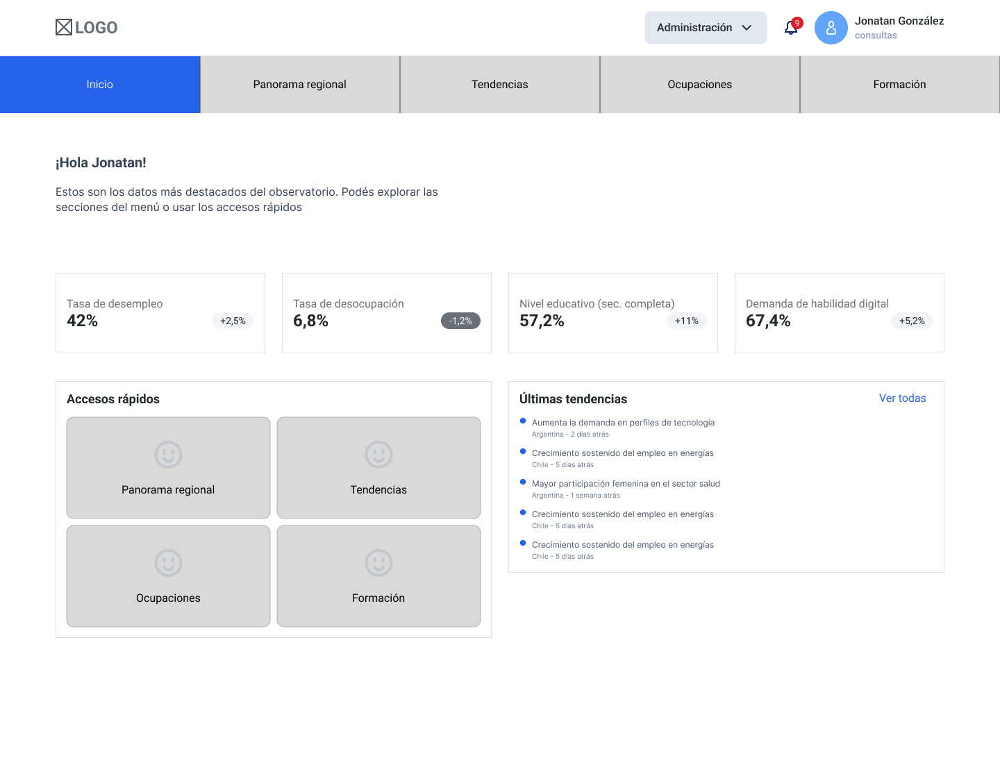
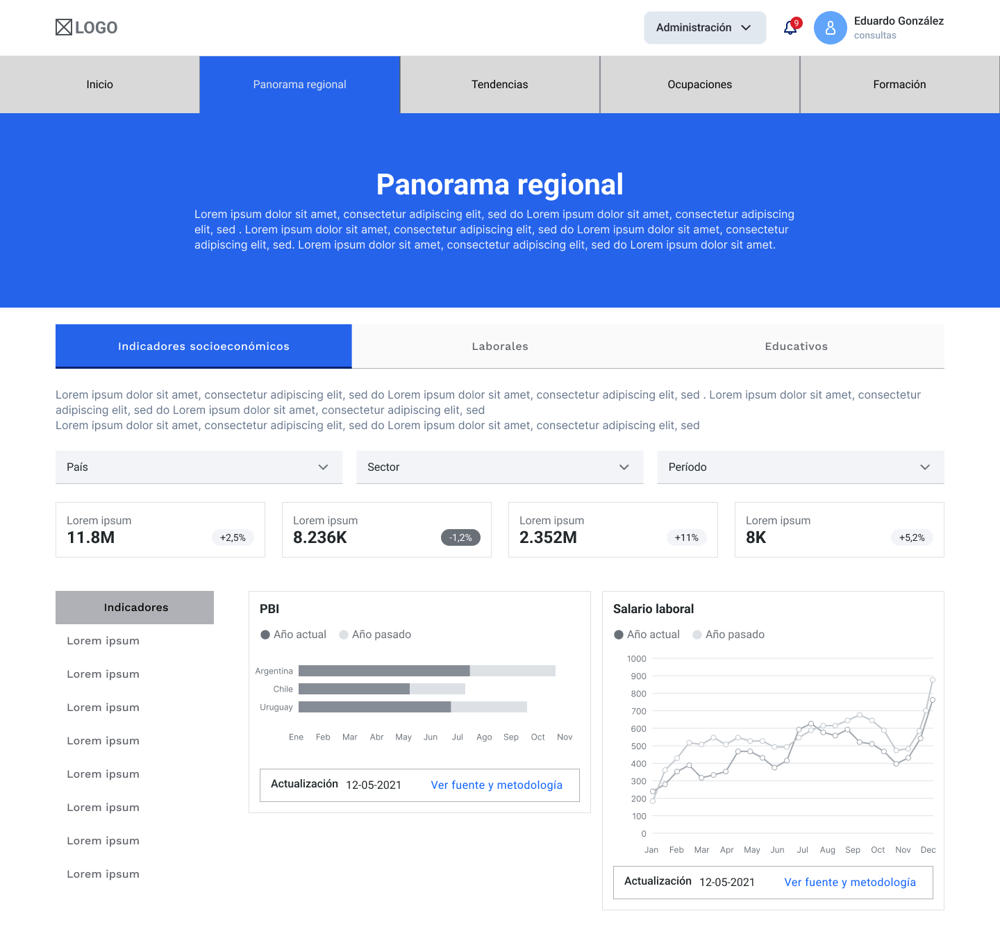
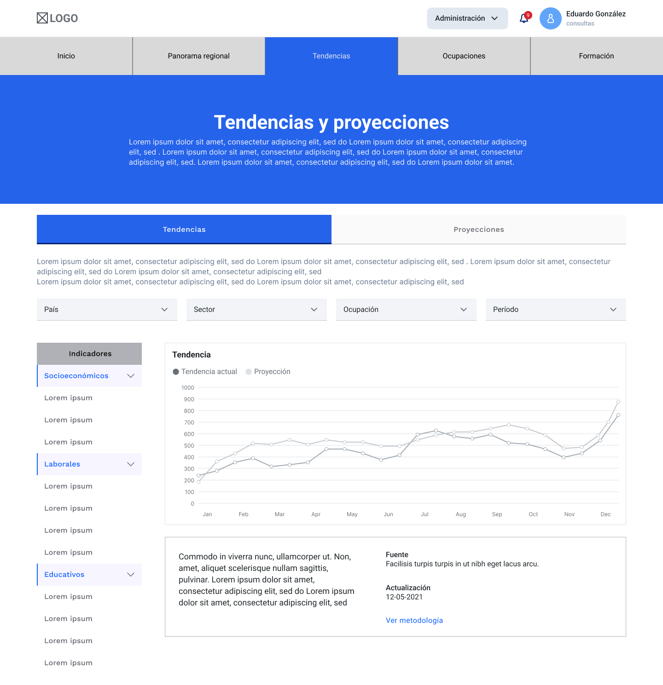

# Exploración de Wireframes & Arquitectura de Información (Zona Privada)

> ⚠️ **AVISO DE CONFIDENCIALIDAD Y ESTADO DEL PROYECTO**
> 
> Los esquemas expuestos a continuación corresponden exclusivamente a **iteraciones preliminares, borradores desestimados y conceptos archivados de la zona privada**. 
> 
> * No reflejan la arquitectura final, el flujo funcional ni la propuesta visual activa del equipo.
> * Las propuestas de interfaz vigentes se gestionan de forma privada hasta la entrega oficial del proyecto.

---

## Iteraciones Preliminares (Borradores v1)

### 1. Inicio (Borrador v3)
Vista inicial del Dashboard.

---

### 2. Panorama Regional (Borrador v3)
Esquema conceptual de indicadores macro y gráficos preliminares.

---

### 3. Tendencias y Proyecciones (Borrador v3)
Primer boceto de disposición de filtros y visualización de tendencias.

